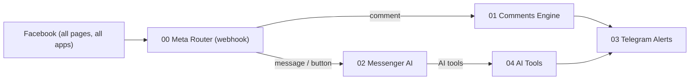
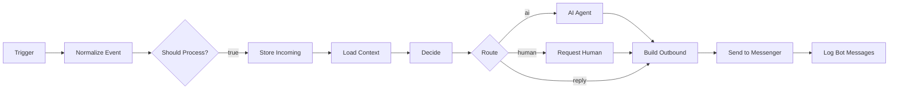
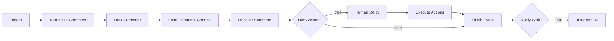

# n8n Workflows — Manual Build Guide (v2)

This guide shows how to build the 5 bot workflows by hand in n8n, one node at a time. Every SQL query and every Code node is ready to copy and paste.
It follows [WORKFLOW_DATA_CONTRACT.md](WORKFLOW_DATA_CONTRACT.md), so the dashboard and the bot read and write the same data.

> [!NOTE]
> Two of these workflows already exist on your n8n, built through the MCP: **KH v2 · 03 Telegram Alerts** (`9DHAecF4osAinNHd`) and **KH v2 · 04 AI Tools** (`gi3su2b3TFtOjoLf`). You can use them as a reference or delete them and build from this guide.

---

## 0. Before you start

### 0.1 Build order

Build **03 → 04 → 02 → 01 → 00**. Each workflow calls the ones before it, so build the sub-workflows first.



| # | Workflow | Trigger | Called by |
|---|---|---|---|
| 03 | Telegram Alerts | Execute Workflow Trigger (accept all data) | 04, 01 |
| 04 | AI Tools | Execute Workflow Trigger (defined fields) | 02 (AI tools + "talk to staff" button) |
| 02 | Messenger AI | Execute Workflow Trigger (accept all data) | 00 |
| 01 | Comments Engine | Execute Workflow Trigger (accept all data) | 00 |
| 00 | Meta Router | 2 Webhooks (GET + POST), same path | Facebook |

### 0.2 One Postgres credential (Supabase)

Every database node uses **one** Postgres credential. Name it `Supabase Postgres`.

| Field | Value |
|---|---|
| Host | Supabase → **Connect** → **Session pooler** host, e.g. `aws-0-eu-central-1.pooler.supabase.com` |
| Port | `5432` (session pooler) |
| Database | `postgres` |
| User | `postgres.<project-ref>` (copy it from the same Connect screen) |
| Password | your database password |
| SSL | `Require`, and turn on **Ignore SSL Issues** |

> [!TIP]
> Use the **Session pooler**, not "Direct connection". The direct host is IPv6-only, and most n8n servers can't reach it.
> This credential connects as the `postgres` role, so RLS doesn't block it. Only use it inside n8n.

### 0.3 n8n server environment variable

The Code nodes use Node's `crypto` module to sign Graph calls (`appsecret_proof`) and to verify Facebook's signature. Add this to n8n's environment, then restart n8n:

```env
NODE_FUNCTION_ALLOW_BUILTIN=crypto
```

If you skip it, everything still works until you turn on **Require App Secret** in the Meta app. Signature checking also stays off.

### 0.4 Conventions used in every workflow

**Postgres nodes.** Always use Operation **Execute Query**.

- Pass values only through **Options → Query Parameters**, written as an **array expression**:
  ```
  {{ [ $json.a, $json.b ] }}
  ```
  Then use `$1`, `$2` … in the SQL. The array form is safe even when a value contains commas or quotes.
- When a whole object is needed, send it as **one JSON parameter** and read it with `$1::jsonb`:
  ```
  {{ [ JSON.stringify($json) ] }}
  ```
- Many queries also **return the payload you sent** (`... , p.j AS ev`). That carries the data forward, so later nodes never lose it.
- If a node receives **more than one item**, set **Options → Query Batching → Independently** (one query per item).

**Code nodes.** Mode **Run Once for All Items** unless stated otherwise. Language: JavaScript.

**Graph API version:** `v23.0`, the same as the dashboard.

**Node names matter.** Code nodes refer to other nodes by name, for example `$('Decide')`. Name each node **exactly** as written in this guide, or update the references.

---

## 1. Workflow 03 — Telegram Alerts

**Purpose:** send a formatted message to the staff Telegram group. It uses the token and chat ID saved in `/settings`.

**Input:** one item that has an `alert_type` field plus the fields for that alert. The SQL in 04 and 01 returns these items directly.

| `alert_type` | Fields used |
|---|---|
| `order` | `order_number, customer_name, customer_phone, delivery_address, items[], subtotal, delivery_fee, total_amount, customer_notes` |
| `complaint` | `ticket_number, customer_name, customer_phone, issue_description, order_number` |
| `human` | `name, phone, contact_id` |
| `comment_complaint` | `ticket_number, commenter_name, comment_text, comment_id` |

### Nodes

**1. `When Executed by Another Workflow`**
- Type: Execute Workflow Trigger.
- Input data mode: **Accept all data**.

**2. `Load Telegram Settings`** (Postgres, Execute Query)

```sql
SELECT notify_telegram, telegram_bot_token, telegram_chat_id, restaurant_name,
       $1::jsonb AS alert
FROM bot_settings
LIMIT 1;
```

Query Parameters: `{{ [ JSON.stringify($json) ] }}`

**3. `Format Alert`** (Code)

```js
// Builds the Telegram HTML message. Returns nothing when alerts are off → workflow stops.
const DASHBOARD_URL = 'https://YOUR-DASHBOARD-DOMAIN/dashboard'; // ← change me

const s = $json;
if (!s.notify_telegram || !s.telegram_bot_token || !s.telegram_chat_id) return [];

const a = s.alert || {};
const esc = (v) => String(v ?? '').replace(/&/g, '&amp;').replace(/</g, '&lt;').replace(/>/g, '&gt;');
const money = (v) => (v === null || v === undefined || v === '') ? '' : `${Number(v)} ج.م`;
let lines = [];

switch (a.alert_type) {
  case 'order': {
    lines.push(`🍗 <b>أوردر جديد #${esc(a.order_number)}</b>`);
    lines.push(`👤 ${esc(a.customer_name)}  📞 ${esc(a.customer_phone)}`);
    lines.push(`📍 ${esc(a.delivery_address)}`);
    lines.push('');
    for (const it of a.items || []) {
      const price = it.unit_price != null ? ` — ${money(it.unit_price * (it.qty || 1))}` : '';
      lines.push(`• ${esc(it.name)} × ${esc(it.qty || 1)}${price}${it.notes ? ` (${esc(it.notes)})` : ''}`);
    }
    lines.push('');
    if (Number(a.subtotal) > 0) lines.push(`الحساب: ${money(a.subtotal)}`);
    if (Number(a.delivery_fee) > 0) lines.push(`التوصيل: ${money(a.delivery_fee)}`);
    if (Number(a.total_amount) > 0) lines.push(`<b>الإجمالي: ${money(a.total_amount)}</b>`);
    if (a.customer_notes) lines.push(`📝 ${esc(a.customer_notes)}`);
    lines.push(`\n<a href="${DASHBOARD_URL}/orders">فتح الأوردرات</a>`);
    break;
  }
  case 'complaint':
    lines.push(`⚠️ <b>شكوى جديدة #${esc(a.ticket_number)}</b>`);
    lines.push(`👤 ${esc(a.customer_name)}${a.customer_phone ? `  📞 ${esc(a.customer_phone)}` : ''}`);
    if (a.order_number) lines.push(`🧾 على الأوردر #${esc(a.order_number)}`);
    lines.push(`\n${esc(a.issue_description)}`);
    lines.push(`\n<a href="${DASHBOARD_URL}/complaints">فتح الشكاوى</a>`);
    break;
  case 'human':
    lines.push('🙋 <b>عميل طالب يكلم موظف</b>');
    lines.push(`👤 ${esc(a.name || 'عميل')}${a.phone ? `  📞 ${esc(a.phone)}` : ''}`);
    lines.push(`\n<a href="${DASHBOARD_URL}/chat?contactId=${esc(a.contact_id)}">فتح المحادثة</a>`);
    break;
  case 'comment_complaint':
    lines.push(`💬⚠️ <b>تعليق شكوى${a.ticket_number ? ` — تذكرة #${esc(a.ticket_number)}` : ''}</b>`);
    lines.push(`👤 ${esc(a.commenter_name || 'مستخدم')}`);
    lines.push(`\n"${esc(a.comment_text)}"`);
    lines.push(`\n<a href="https://facebook.com/${esc(a.comment_id)}">فتح التعليق</a> · <a href="${DASHBOARD_URL}/comments">صندوق التعليقات</a>`);
    break;
  default:
    lines.push(`🔔 ${esc(a.text || JSON.stringify(a))}`);
}

return [{ json: {
  token: s.telegram_bot_token,
  body: {
    chat_id: s.telegram_chat_id,
    text: `<b>${esc(s.restaurant_name)}</b>\n` + lines.join('\n'),
    parse_mode: 'HTML',
    disable_web_page_preview: true,
  },
} }];
```

**4. `Send Telegram`** (HTTP Request)

| Setting | Value |
|---|---|
| Method | `POST` |
| URL | `https://api.telegram.org/bot{{ $json.token }}/sendMessage` |
| Send Body | ON, **JSON**, **Using JSON**, value `{{ $json.body }}` |
| Settings → On Error | **Continue** (a Telegram failure must never break orders) |

Save the workflow as **KH v2 · 03 Telegram Alerts**. It doesn't need to be active, because it is only called by other workflows. Copy its **workflow ID** from the URL.

---

## 2. Workflow 04 — AI Tools

**Purpose:** the actions the AI can take. Each AI tool in 02 calls this workflow with a fixed `action`.

### Nodes

**1. `When Executed by Another Workflow`** (Execute Workflow Trigger)

Input data mode: **Define using fields below**. Every field is type **String**:

`action`, `contact_id`, `channel_id`, `items_json`, `customer_name`, `phone`, `address`, `notes`, `description`, `order_number`

**2. `Route Action`** (Switch, mode Rules). Value `{{ $json.action }}`, with one rule per output:

| Output | Rule (String → is equal to) |
|---|---|
| 0 | `create_order` |
| 1 | `create_complaint` |
| 2 | `request_human` |
| 3 | `send_menu` |
| Fallback | Options → Fallback Output → **Extra Output** |

> [!IMPORTANT]
> A sub-workflow returns the output of the **last node that ran**. Every branch must therefore end with its own "Result" node, and the Telegram call must come **before** it.

### 2A. Branch `create_order`

**`Prepare Order`** (Code)

```js
// Validates what the AI sent and computes totals. Arabic digits → Latin.
const i = $json;
const toLatin = (s) => String(s ?? '').replace(/[٠-٩]/g, (d) => '٠١٢٣٤٥٦٧٨٩'.indexOf(d)).replace(/[۰-۹]/g, (d) => '۰۱۲۳۴۵۶۷۸۹'.indexOf(d));

let items = [];
try { items = JSON.parse(i.items_json || '[]'); } catch (e) { items = []; }
if (!Array.isArray(items)) items = [];
items = items.map((x) => {
  const price = x.unit_price ?? x.price;
  const n = price === '' || price === null || price === undefined ? null : Number(toLatin(price));
  return {
    name: String(x.name ?? x.item ?? '').trim(),
    qty: Math.max(1, parseInt(toLatin(x.qty ?? x.quantity ?? 1), 10) || 1),
    unit_price: Number.isFinite(n) ? n : null,
    notes: String(x.notes ?? '').trim(),
  };
}).filter((x) => x.name);

const phone = toLatin(i.phone).replace(/[^\d+]/g, '');
const missing = [];
if (!items.length) missing.push('الأصناف');
if (!String(i.customer_name || '').trim()) missing.push('الاسم');
if (phone.replace(/\D/g, '').length < 10) missing.push('رقم موبايل صحيح');
if (String(i.address || '').trim().length < 5) missing.push('العنوان بالتفصيل');

if (missing.length) {
  return [{ json: { valid: false, response: `لم يتم تسجيل الأوردر. ناقص: ${missing.join('، ')}. اسأل العميل عنها ثم أعد المحاولة.` } }];
}

const subtotal = items.reduce((sum, x) => sum + (x.unit_price != null ? x.unit_price * x.qty : 0), 0);
return [{ json: { valid: true, payload: {
  contact_id: i.contact_id, channel_id: i.channel_id || null,
  customer_name: String(i.customer_name).trim(), phone, address: String(i.address).trim(),
  notes: String(i.notes || '').trim(), items, subtotal,
} } }];
```

**`Order Valid?`** (IF): `{{ $json.valid }}` is true (Boolean).
- **false** → **`Order Invalid Result`** (Set): one field `response` = `{{ $json.response }}`. End of the branch.
- **true** → **`Insert Order`** (Postgres)

```sql
WITH p AS (SELECT $1::jsonb AS j),
s AS (SELECT COALESCE(delivery_fee, 0) AS fee FROM bot_settings LIMIT 1),
o AS (
  INSERT INTO orders (contact_id, channel_id, customer_name, customer_phone, delivery_address,
                      customer_notes, subtotal, delivery_fee, total_amount, status, source)
  SELECT (p.j->>'contact_id')::uuid,
         NULLIF(p.j->>'channel_id', '')::uuid,
         p.j->>'customer_name', p.j->>'phone', p.j->>'address',
         NULLIF(p.j->>'notes', ''),
         (p.j->>'subtotal')::numeric,
         COALESCE((SELECT fee FROM s), 0),
         (p.j->>'subtotal')::numeric + COALESCE((SELECT fee FROM s), 0),
         'confirmed', 'messenger'
  FROM p
  RETURNING id, order_number, customer_name, customer_phone, delivery_address,
            customer_notes, subtotal, delivery_fee, total_amount
),
i AS (
  INSERT INTO order_items (order_id, item_name, quantity, unit_price, total_price, notes)
  SELECT o.id, x->>'name', (x->>'qty')::int,
         NULLIF(x->>'unit_price', '')::numeric,
         NULLIF(x->>'unit_price', '')::numeric * (x->>'qty')::int,
         NULLIF(x->>'notes', '')
  FROM o, p, jsonb_array_elements(p.j->'items') AS x
  RETURNING 1
),
c AS (
  UPDATE contacts SET
    name    = COALESCE(NULLIF(p.j->>'customer_name', ''), contacts.name),
    phone   = COALESCE(NULLIF(p.j->>'phone', ''), contacts.phone),
    address = COALESCE(NULLIF(p.j->>'address', ''), contacts.address)
  FROM p
  WHERE contacts.id = (p.j->>'contact_id')::uuid
  RETURNING 1
)
SELECT 'order' AS alert_type, o.*, p.j->'items' AS items, (SELECT count(*) FROM i) AS items_count
FROM o, p;
```

Query Parameters: `{{ [ JSON.stringify($json.payload) ] }}`

**`Alert Order`** (Execute Workflow)

| Setting | Value |
|---|---|
| Source | Database |
| Workflow | **03 Telegram Alerts** (from the list, or by ID) |
| Mode | Run once with all items |
| Options → Wait For Sub-Workflow Completion | **OFF** |

**`Order Result`** (Code)

```js
const o = $('Insert Order').first().json;
const fee = Number(o.delivery_fee) > 0 ? ` + توصيل ${Number(o.delivery_fee)} ج.م` : '';
const total = Number(o.total_amount) > 0 ? ` — الإجمالي ${Number(o.total_amount)} ج.م` : '';
return [{ json: { response: `تم تسجيل الأوردر بنجاح. رقم الأوردر #${o.order_number}${total}${fee}. أبلغ العميل برقم الأوردر واشكره.` } }];
```

### 2B. Branch `create_complaint`

**`Prepare Complaint`** (Code)

```js
const i = $json;
const toLatin = (s) => String(s ?? '').replace(/[٠-٩]/g, (d) => '٠١٢٣٤٥٦٧٨٩'.indexOf(d));
return [{ json: { payload: {
  contact_id: i.contact_id,
  description: String(i.description || '').trim() || 'شكوى من العميل (بدون تفاصيل)',
  order_number: toLatin(i.order_number).replace(/\D/g, ''),   // '' = use the latest order from the last 48h
} } }];
```

**`Insert Complaint`** (Postgres)

```sql
WITH p AS (SELECT $1::jsonb AS j),
ct AS (SELECT id, name, phone FROM contacts WHERE id = (SELECT (j->>'contact_id')::uuid FROM p)),
ord AS (
  SELECT o.id, o.order_number
  FROM orders o, p
  WHERE o.contact_id = (p.j->>'contact_id')::uuid
    AND (
      (NULLIF(p.j->>'order_number', '') IS NOT NULL AND o.order_number = (p.j->>'order_number')::bigint)
      OR (NULLIF(p.j->>'order_number', '') IS NULL AND o.created_at > now() - interval '48 hours')
    )
  ORDER BY o.created_at DESC
  LIMIT 1
),
ins AS (
  INSERT INTO complaints (contact_id, customer_name, customer_phone, issue_description, order_id, source, status, priority)
  SELECT (SELECT id FROM ct),
         COALESCE(NULLIF((SELECT name FROM ct), ''), 'عميل ماسنجر'),
         (SELECT phone FROM ct),
         p.j->>'description',
         (SELECT id FROM ord),
         'messenger', 'open', 'medium'
  FROM p
  RETURNING id, ticket_number, customer_name, customer_phone, issue_description, order_id
)
SELECT 'complaint' AS alert_type, ins.*, (SELECT order_number FROM ord) AS order_number
FROM ins;
```

Query Parameters: `{{ [ JSON.stringify($json.payload) ] }}`

**`Alert Complaint`**: Execute Workflow → 03, wait **OFF**, the same settings as `Alert Order`.

**`Complaint Result`** (Code)

```js
const c = $('Insert Complaint').first().json;
const ord = c.order_number ? ` ومربوطة بالأوردر #${c.order_number}` : '';
return [{ json: { response: `تم تسجيل الشكوى برقم #${c.ticket_number}${ord}. اعتذر للعميل بلطف وطمّنه إن الإدارة هتتواصل معاه في أقرب وقت.` } }];
```

> The database already does two things automatically: it sets the linked order to **عليه مشكلة**, and it pauses the AI for this customer when **auto_pause_on_complaint** is on. Don't do these in n8n.

### 2C. Branch `request_human`

**`Flag Human`** (Postgres)

```sql
WITH u AS (
  UPDATE contacts SET ai_enabled = false, needs_human = true
  WHERE id = $1::uuid
  RETURNING id, name, phone
)
SELECT 'human' AS alert_type, u.id AS contact_id, u.name, u.phone,
       (SELECT human_handoff_message FROM bot_settings LIMIT 1) AS handoff
FROM u;
```

Query Parameters: `{{ [ $json.contact_id ] }}`

**`Alert Human`**: Execute Workflow → 03, wait **OFF**.

**`Human Result`** (Code)

```js
const h = $('Flag Human').first().json;
const msg = h.handoff || 'تمام يا فندم 🙏 تم تحويلك لموظف خدمة العملاء، وهيرد على حضرتك في أقرب وقت.';
return [{ json: { response: `تم تحويل العميل لموظف. رد على العميل بالرسالة دي بالظبط ومتضيفش حاجة: ${msg}`, handoff: msg } }];
```

### 2D. Branch `send_menu`

**`Menu Result`** (Set): field `response` = `تم. صور المنيو هتتبعت للعميل تلقائياً بعد ردك. اكتب جملة قصيرة زي: "ده المنيو يا فندم 👇 تحب تطلب إيه؟"`

> 02 sends the actual images. It sees in the AI's steps that `send_menu` was called.

### 2E. Fallback

**`Unknown Action`** (Set): field `response` = `أداة غير معروفة.`

Save the workflow as **KH v2 · 04 AI Tools** and copy its ID.

---

## 3. Workflow 02 — Messenger AI

**Input from the router:**

```json
{ "kind": "messaging",
  "channel": { "id": "<channels.id>", "page_id": "<FB page id>", "name": "...", "token": "<page token>", "app_secret": "..." },
  "event":   { "sender": {"id": "PSID"}, "recipient": {"id": "PAGE"}, "timestamp": 0, "message": {...} | "postback": {...} } }
```

### Node map



**1. `When Executed by Another Workflow`**: Accept all data.

**2. `Normalize Event`** (Code)

```js
const { channel, event: e } = $json;
const psid = e?.sender?.id ? String(e.sender.id) : '';
const base = {
  channel_id: channel.id, page_id: String(channel.page_id), page_name: channel.name || '',
  token: channel.token, app_secret: channel.app_secret || '', psid,
  mid: null, text: '', payload: null, raw_payload: null, media_url: null, media_type: null,
  skip: false, skip_reason: null,
};
const skip = (reason) => [{ json: { ...base, skip: true, skip_reason: reason } }];

if (!psid || psid === base.page_id) return skip('no_sender_or_page');
if (e.message?.is_echo) return skip('echo');               // page/staff outgoing copy
if (e.read || e.delivery || e.reaction) return skip('receipt');

const ATT = { image: '[صورة]', audio: '[رسالة صوتية]', video: '[فيديو]', file: '[ملف]', location: '[موقع]' };

if (e.postback) {
  base.raw_payload = String(e.postback.payload || '');
  base.payload = base.raw_payload.toUpperCase();
  base.text = e.postback.title || base.raw_payload;
  base.mid = `pb_${psid}_${e.timestamp || Date.now()}`;      // postbacks have no mid → synthetic dedupe key
} else if (e.message) {
  base.mid = e.message.mid || `m_${psid}_${e.timestamp || Date.now()}`;
  base.text = String(e.message.text || '');
  if (e.message.quick_reply?.payload) {
    base.raw_payload = String(e.message.quick_reply.payload);
    base.payload = base.raw_payload.toUpperCase();
  }
  const att = e.message.attachments?.[0];
  if (att) {
    base.media_type = att.type;
    base.media_url = att.payload?.url || null;
    if (!base.text) base.text = e.message.sticker_id ? '👍' : (ATT[att.type] || '[مرفق]');
  }
  if (!base.text) return skip('empty');
} else {
  return skip('unsupported');
}
return [{ json: base }];
```

**3. `Should Process?`** (IF): `{{ $json.skip }}` is **false**. Leave the false output unconnected.

**4. `Store Incoming`** (Postgres). It upserts the contact, stores the message and blocks duplicates.

```sql
WITH ev AS (SELECT $1::jsonb AS j),
up AS (
  INSERT INTO contacts (platform, platform_user_id, channel_id, last_interaction_at)
  SELECT 'messenger', j->>'psid', (j->>'channel_id')::uuid, now() FROM ev
  ON CONFLICT (platform_user_id) DO UPDATE
    SET channel_id = COALESCE(contacts.channel_id, EXCLUDED.channel_id),
        last_interaction_at = now()
  RETURNING id, name, phone, address, ai_enabled, needs_human, total_orders,
            (xmax = 0) AS is_new_contact
),
msg AS (
  INSERT INTO messages (contact_id, sender_type, content, media_url, media_type, platform_message_id)
  SELECT up.id, 'user', NULLIF(ev.j->>'text', ''), NULLIF(ev.j->>'media_url', ''),
         NULLIF(ev.j->>'media_type', ''), ev.j->>'mid'
  FROM up, ev
  ON CONFLICT (platform_message_id) WHERE platform_message_id IS NOT NULL DO NOTHING
  RETURNING id
)
SELECT up.id AS contact_id, up.name, up.phone, up.address, up.ai_enabled, up.needs_human,
       up.total_orders, up.is_new_contact,
       EXISTS (SELECT 1 FROM msg) AS is_new_message,
       ev.j AS ev
FROM up, ev;
```

Query Parameters: `{{ [ JSON.stringify($json) ] }}`

> **Optional: customer name and photo.** Add these between nodes 4 and 5.
> 1. An IF node: `{{ !$json.name }}`.
> 2. An HTTP GET to `https://graph.facebook.com/v23.0/{{ $json.ev.psid }}?fields=first_name,last_name,profile_pic&access_token={{ $json.ev.token }}` with On Error → Continue.
> 3. A Postgres `UPDATE contacts SET name = $2, profile_pic_url = $3 WHERE id = $1::uuid`.
>
> If you add it, merge back before `Load Context`. Every later node reads `Store Incoming` by name, so the extra branch changes nothing downstream.

**5. `Load Context`** (Postgres)

```sql
WITH p AS (SELECT $1::uuid AS contact_id),
s AS (SELECT * FROM bot_settings LIMIT 1)
SELECT
  (SELECT row_to_json(s) FROM s) AS settings,
  COALESCE((
    SELECT json_agg(o ORDER BY o.sort_order, o.created_at DESC)
    FROM (SELECT title, description, price_before, price_after, banner_url, sort_order, created_at
          FROM offers
          WHERE is_active
            AND (start_date IS NULL OR start_date <= now())
            AND (end_date IS NULL OR end_date >= now())) o
  ), '[]'::json) AS offers,
  COALESCE((
    SELECT json_agg(m ORDER BY m.created_at)
    FROM (SELECT sender_type, content, created_at FROM messages
          WHERE contact_id = p.contact_id AND content IS NOT NULL
          ORDER BY created_at DESC LIMIT 20) m
  ), '[]'::json) AS history,
  EXISTS (
    SELECT 1 FROM messages m, s
    WHERE m.contact_id = p.contact_id AND m.sender_type = 'bot'
      AND m.created_at > now() - interval '12 hours'
      AND m.content = replace(replace(COALESCE(s.off_hours_message, ''),
                    '{open_time}', to_char(s.open_time, 'HH24:MI')),
                    '{close_time}', to_char(s.close_time, 'HH24:MI'))
  ) AS off_hours_sent_recently
FROM p;
```

Query Parameters: `{{ [ $json.contact_id ] }}`

**6. `Decide`** (Code). This is the brain: the switches, business hours, buttons, welcome message and AI prompt.

```js
const st  = $('Store Incoming').first().json;
const ctx = $('Load Context').first().json;
const s   = ctx.settings || {};
const ev  = st.ev;
const offers  = ctx.offers || [];
const history = ctx.history || [];
const CUR = 'ج.م';

const base = { contact_id: st.contact_id, channel_id: ev.channel_id, page_id: ev.page_id,
               token: ev.token, app_secret: ev.app_secret, psid: ev.psid };
const out = (action, extra = {}) => [{ json: { ...base, action, ...extra } }];

// ---- menu / offers message builders (also used by Build Outbound via menu_messages) ----
const stripMd = (t) => String(t || '').replace(/^#{1,6}\s*/gm, '').replace(/\*\*(.+?)\*\*/g, '$1').replace(/^\s*[-*]\s+/gm, '• ');
function menuMessages() {
  const msgs = [];
  for (const url of (s.menu_images || []).slice(0, 10)) msgs.push({ type: 'image', url });
  if (s.menu_pdf_url) msgs.push({ type: 'text', text: `📄 المنيو كامل PDF:\n${s.menu_pdf_url}` });
  if (!msgs.length && s.price_list) msgs.push({ type: 'text', text: stripMd(s.price_list) });
  if (!msgs.length) msgs.push({ type: 'text', text: 'المنيو بيتحدّث دلوقتي 🙏 قولّي تحب تطلب إيه وأنا أساعدك.' });
  return msgs;
}
function offerMessages() {
  if (!offers.length) return [{ type: 'text', text: 'مفيش عروض شغالة دلوقتي يا فندم 🙏 تحب تشوف المنيو؟',
    quick_replies: [{ title: '📋 المنيو', payload: 'VIEW_MENU' }] }];
  const elements = offers.slice(0, 10).map((o) => {
    const price = o.price_after != null
      ? `${o.price_after} ${CUR}${o.price_before != null ? ` بدل ${o.price_before}` : ''}` : '';
    const el = {
      title: String(o.title).slice(0, 80),
      subtitle: [price, o.description].filter(Boolean).join(' — ').slice(0, 80) || ' ',
      buttons: [{ type: 'postback', title: '🛵 اطلب العرض ده', payload: `OFFER:${String(o.title).slice(0, 200)}` }],
    };
    if (o.banner_url) el.image_url = o.banner_url;
    return el;
  });
  return [{ type: 'text', text: '🔥 العروض الحالية:' }, { type: 'generic', elements }];
}
const QUICK = [
  { title: '📋 المنيو', payload: 'VIEW_MENU' },
  { title: '🔥 العروض', payload: 'VIEW_OFFERS' },
  { title: '🛵 اطلب دلوقتي', payload: 'START_ORDER' },
  { title: '🙋 كلم موظف', payload: 'HUMAN_AGENT' },
];

// ---- 1. hard stops ----
if (!st.is_new_message) return out('stop', { reason: 'duplicate' });
if (s.bot_enabled === false) return out('stop', { reason: 'bot_off' });
if (st.ai_enabled === false) return out('stop', { reason: 'human_mode' });

// ---- 2. business hours (Cairo; closing after midnight supported) ----
const hhmm = (t) => String(t || '00:00').slice(0, 5);
const toMin = (t) => { const [h, m] = hhmm(t).split(':').map(Number); return (h || 0) * 60 + (m || 0); };
if (s.business_hours_enabled) {
  const now = DateTime.now().setZone('Africa/Cairo');
  const cur = now.hour * 60 + now.minute, o = toMin(s.open_time), c = toMin(s.close_time);
  const open = o === c ? true : (o < c ? (cur >= o && cur < c) : (cur >= o || cur < c));
  if (!open) {
    if (ctx.off_hours_sent_recently) return out('stop', { reason: 'off_hours_already_sent' });
    const msg = String(s.off_hours_message || 'إحنا حالياً خارج مواعيد العمل 🙏')
      .replaceAll('{open_time}', hhmm(s.open_time)).replaceAll('{close_time}', hhmm(s.close_time));
    return out('reply', { outbound: [{ type: 'text', text: msg }] });
  }
}

// ---- 3. welcome + buttons ----
const pre = [];
if (st.is_new_contact && s.welcome_message) pre.push({ type: 'text', text: s.welcome_message, quick_replies: QUICK });
const P = ev.payload || '';
let userText = ev.text || '';

if (P === 'VIEW_MENU')   return out('reply', { outbound: [...pre, ...menuMessages()] });
if (P === 'VIEW_OFFERS') return out('reply', { outbound: [...pre, ...offerMessages()] });
if (P === 'HUMAN_AGENT') return out('human', { outbound: pre });
if (P === 'START_ORDER') userText = 'عايز أطلب أوردر';
if (String(ev.raw_payload || '').startsWith('OFFER:')) userText = `عايز أطلب العرض ده: ${ev.raw_payload.slice(6)}`;

// New customer who only said hi → welcome + buttons is enough
if (pre.length && !P && userText.trim().length <= 20) return out('reply', { outbound: pre });

// ---- 4. AI prompt ----
const offersText = offers.length
  ? offers.map((o) => `- ${o.title}${o.price_after != null ? `: ${o.price_after} ${CUR}` : ''}${o.price_before != null ? ` (بدل ${o.price_before})` : ''}${o.description ? ` — ${o.description}` : ''}`).join('\n')
  : 'لا توجد عروض حالياً.';
const known = [
  st.name ? `الاسم: ${st.name}` : null,
  st.phone ? `الموبايل: ${st.phone}` : null,
  st.address ? `العنوان: ${st.address}` : null,
  `عدد الأوردرات السابقة: ${st.total_orders || 0}`,
].filter(Boolean).join('\n');

const system_prompt = `${s.ai_system_prompt || 'أنت مساعد طلبات لمطعم فراخ مقلية.'}

## بيانات المطعم
- الاسم: ${s.restaurant_name || ''}
- مصاريف التوصيل: ${Number(s.delivery_fee || 0)} ${CUR}
- الدفع: كاش عند الاستلام
${s.business_hours_enabled ? `- مواعيد العمل: من ${hhmm(s.open_time)} إلى ${hhmm(s.close_time)}` : ''}

## قائمة الأسعار (المصدر الوحيد لأي سعر)
${s.price_list || 'غير متوفرة. لو العميل سأل عن سعر قوله إن الموظف هيأكد السعر مع الأوردر.'}

## العروض الحالية
${offersText}

## بيانات العميل المعروفة (لو موجودة أكدها بدل ما تسأل تاني)
${known}

## الأدوات
- send_menu: لما العميل يطلب المنيو أو الصور أو "عندكم إيه".
- create_order: فقط بعد ما تعرض ملخص الأوردر (الأصناف والكميات والأسعار والتوصيل والإجمالي والاسم والموبايل والعنوان) والعميل يوافق صراحة. ابعت items_json كـ JSON array: [{"name":"...","qty":1,"unit_price":0,"notes":""}].
- create_complaint: لما العميل يشتكي من أوردر أو خدمة. ابعت وصف الشكوى ورقم الأوردر لو ذكره.
- request_human: لما العميل يطلب يكلم موظف أو مدير، أو لو مش قادر تساعده. بعدها رد بالرسالة اللي الأداة ترجعها بالظبط.

## أسلوب الرد
- لهجة مصرية ودودة، رد قصير (من سطر لـ 4 سطور).
- ممنوع Markdown (لا ** ولا #) لأن ماسنجر مش بيعرضه. استخدم إيموجي خفيف.
- متخترعش أسعار أو أصناف مش موجودة في قائمة الأسعار.`;

const label = { user: 'العميل', bot: 'البوت', agent: 'الموظف' };
const convo = history.map((m) => `${label[m.sender_type] || m.sender_type}: ${m.content}`).join('\n');
const user_prompt = `المحادثة حتى الآن:\n${convo}\n\nآخر رسالة من العميل: ${userText}\n\nاكتب ردك على آخر رسالة فقط.`;

return out('ai', { outbound: pre, system_prompt, user_prompt, menu_messages: menuMessages() });
```

> The `menu_messages` field lets Build Outbound send the menu images when the AI calls `send_menu`.

**7. `Route`** (Switch, Rules). Value `{{ $json.action }}`:

| Output | Equals | Connects to |
|---|---|---|
| 0 | `ai` | `AI Agent` |
| 1 | `human` | `Request Human` |
| 2 | `reply` | `Build Outbound` |

`stop` matches no rule, so the workflow ends there.

**8. `AI Agent`** (AI Agent node, Tools Agent)

| Setting | Value |
|---|---|
| Source for Prompt | **Define below** → `{{ $json.user_prompt }}` |
| Options → System Message | `{{ $json.system_prompt }}` |
| Options → Max Iterations | `6` |
| Options → Return Intermediate Steps | **ON** (required, so we can detect `send_menu`) |

- **Chat Model:** attach any model you like (Gemini, OpenAI …). The prompt is model-neutral.
- **Memory:** none. The history is already inside `user_prompt`.
- **Tools:** 4 × **Call n8n Workflow Tool**. The **node name is the tool name**, so name them exactly as below. For each one:
  - Source: Database.
  - Workflow: **04 AI Tools**.
  - The Workflow Inputs fields appear automatically. Leave unused fields empty.

| Tool node name | Description (for the AI) | Workflow inputs |
|---|---|---|
| `create_order` | تسجيل أوردر جديد بعد موافقة العميل الصريحة على الملخص | `action` = `create_order` · `contact_id` = `{{ $('Decide').first().json.contact_id }}` · `channel_id` = `{{ $('Decide').first().json.channel_id }}` · `items_json` = `{{ $fromAI('items_json', 'JSON array of items: [{"name":"","qty":1,"unit_price":0,"notes":""}]', 'string') }}` · `customer_name` = `{{ $fromAI('customer_name', 'اسم العميل', 'string') }}` · `phone` = `{{ $fromAI('phone', 'رقم موبايل العميل', 'string') }}` · `address` = `{{ $fromAI('address', 'عنوان التوصيل بالتفصيل', 'string') }}` · `notes` = `{{ $fromAI('notes', 'ملاحظات الأوردر أو فاضي', 'string') }}` |
| `create_complaint` | تسجيل شكوى العميل | `action` = `create_complaint` · `contact_id` / `channel_id` as above · `description` = `{{ $fromAI('description', 'وصف الشكوى بالتفصيل', 'string') }}` · `order_number` = `{{ $fromAI('order_number', 'رقم الأوردر لو العميل ذكره، أو فاضي', 'string') }}` |
| `request_human` | تحويل العميل لموظف بشري | `action` = `request_human` · `contact_id` / `channel_id` as above |
| `send_menu` | إرسال صور المنيو للعميل | `action` = `send_menu` · `contact_id` as above |

**9. `Request Human`** (Execute Workflow → **04 AI Tools**, wait **ON**). Workflow Inputs:
- `action` = `request_human`
- `contact_id` = `{{ $json.contact_id }}`
- `channel_id` = `{{ $json.channel_id }}`

**10. `Build Outbound`** (Code). All three Route paths connect into this node.

```js
const d = $('Decide').first().json;
const s = $('Load Context').first().json.settings || {};
let msgs = [...(d.outbound || [])];

const clean = (t) => String(t || '')
  .replace(/\*\*(.+?)\*\*/g, '$1').replace(/__(.+?)__/g, '$1')
  .replace(/^#{1,6}\s*/gm, '').replace(/^\s*[-*]\s+/gm, '• ').trim();

if (d.action === 'ai') {
  const a = $('AI Agent').first().json;
  const used = (a.intermediateSteps || []).map((x) => x?.action?.tool).filter(Boolean);
  const text = clean(a.output);
  if (text) msgs.push({ type: 'text', text });
  if (used.includes('send_menu')) msgs.push(...(d.menu_messages || []));
}
if (d.action === 'human') {
  msgs.push({ type: 'text', text: s.human_handoff_message || 'تمام يا فندم 🙏 تم تحويلك لموظف، وهيرد عليك في أقرب وقت.' });
}

// ---- convert to Graph Send API bodies ----
const chunk = (t, n = 1900) => { const r = []; let x = String(t); while (x.length > n) { let i = x.lastIndexOf('\n', n); if (i < n / 2) i = n; r.push(x.slice(0, i)); x = x.slice(i).trim(); } if (x) r.push(x); return r; };
const qr = (list) => list.slice(0, 13).map((q) => ({ content_type: 'text', title: String(q.title).slice(0, 20), payload: q.payload }));

const items = [];
const push = (message, log) => items.push({ json: {
  contact_id: d.contact_id, page_id: d.page_id, token: d.token, app_secret: d.app_secret,
  body: { recipient: { id: d.psid }, messaging_type: 'RESPONSE', message }, ...log,
} });

for (const m of msgs) {
  if (m.type === 'text') {
    const parts = chunk(m.text);
    parts.forEach((p, i) => {
      const message = { text: p };
      if (i === parts.length - 1 && m.quick_replies?.length) message.quick_replies = qr(m.quick_replies);
      push(message, { content: p, media_url: null, media_type: null });
    });
  } else if (m.type === 'image') {
    push({ attachment: { type: 'image', payload: { url: m.url, is_reusable: true } } },
         { content: null, media_url: m.url, media_type: 'image' });
  } else if (m.type === 'generic') {
    push({ attachment: { type: 'template', payload: { template_type: 'generic', elements: m.elements } } },
         { content: '🔥 ' + m.elements.map((e) => e.title).join(' | '), media_url: m.elements[0]?.image_url || null, media_type: m.elements[0]?.image_url ? 'image' : null });
  }
}
return items;
```

**11. `Send to Messenger`** (Code). It sends the messages in order and never throws.

```js
const GRAPH = 'v23.0';
let crypto = null;
try { crypto = require('crypto'); } catch (e) { /* NODE_FUNCTION_ALLOW_BUILTIN=crypto not set */ }

function graphError(e) {
  let b = e?.response?.body ?? e?.response?.data ?? e?.cause?.response?.data ?? e?.context?.data;
  if (typeof b === 'string') { try { b = JSON.parse(b); } catch (x) {} }
  const g = b?.error;
  if (g) {
    if (g.error_subcode === 2018278 || g.error_subcode === 2018108)
      return 'خارج نافذة الـ 24 ساعة: فيسبوك يسمح بالرد خلال 24 ساعة من آخر رسالة للعميل';
    return `${g.message} (code ${g.code}${g.error_subcode ? '/' + g.error_subcode : ''})`;
  }
  return e?.description || e?.message || 'Unknown error';
}
const sleep = (ms) => new Promise((r) => (typeof setTimeout === 'function' ? setTimeout(r, ms) : r()));

const results = [];
for (const it of $input.all()) {
  const m = it.json;
  const qs = { access_token: m.token };
  if (crypto && m.app_secret) qs.appsecret_proof = crypto.createHmac('sha256', m.app_secret).update(m.token).digest('hex');
  let message_id = null, error = null;
  try {
    const res = await this.helpers.httpRequest({
      method: 'POST', url: `https://graph.facebook.com/${GRAPH}/${m.page_id}/messages`,
      qs, body: m.body, json: true,
    });
    message_id = res?.message_id || null;
  } catch (e) { error = graphError(e); }
  results.push({ json: { contact_id: m.contact_id, content: m.content, media_url: m.media_url,
                         media_type: m.media_type, message_id, error } });
  await sleep(350); // keep images and text in order
}
return results;
```

**12. `Log Bot Messages`** (Postgres, **Query Batching: Independently**)

```sql
INSERT INTO messages (contact_id, sender_type, content, media_url, media_type, platform_message_id, send_error, is_read)
VALUES ($1::uuid, 'bot', NULLIF($2, ''), NULLIF($3, ''), NULLIF($4, ''), NULLIF($5, ''), NULLIF($6, ''), true);
```

Query Parameters:

```
{{ [ $json.contact_id, $json.content ?? '', $json.media_url ?? '', $json.media_type ?? '', $json.message_id ?? '', $json.error ?? '' ] }}
```

Save the workflow as **KH v2 · 02 Messenger AI** and copy its ID.

---

## 4. Workflow 01 — Comments Engine

**Input from the router:** `{ kind: "comment", channel: {...same as 02}, event: <change.value> }`

`change.value` example:

```json
{ "item": "comment", "verb": "add", "comment_id": "PAGEID_POSTID_COMMENTID", "post_id": "PAGEID_POSTID",
  "parent_id": "PAGEID_POSTID", "message": "بكام الوجبة؟", "created_time": 1730000000,
  "from": { "id": "123", "name": "Ahmed" } }
```



**1. `When Executed by Another Workflow`**: Accept all data.

**2. `Normalize Comment`** (Code)

```js
const { channel, event: v } = $json;
if (!v || v.item !== 'comment' || v.verb !== 'add') return [];
const fromId = String(v.from?.id || '');
if (fromId && fromId === String(channel.page_id)) return [];   // our own replies: don't log, don't loop
const postId = String(v.post_id || '');
const parentId = String(v.parent_id || '');
return [{ json: { cm: {
  comment_id: String(v.comment_id), post_id: postId, parent_id: parentId,
  is_nested: !!parentId && parentId !== postId,
  commenter_id: fromId, commenter_name: v.from?.name || '', text: String(v.message || ''),
  created_time: v.created_time || null,
  channel_id: channel.id, page_id: String(channel.page_id), token: channel.token, app_secret: channel.app_secret || '',
} } }];
```

**3. `Lock Comment`** (Postgres). It handles dedupe: if Facebook sends the same comment twice, no row comes back and the workflow stops.

```sql
WITH c AS (SELECT $1::jsonb AS j),
ins AS (
  INSERT INTO comment_events (comment_id, channel_id, post_id, parent_comment_id, commenter_id,
                              commenter_name, comment_text, comment_created_at, decision)
  SELECT j->>'comment_id', (j->>'channel_id')::uuid, NULLIF(j->>'post_id', ''),
         CASE WHEN (j->>'is_nested')::boolean THEN j->>'parent_id' END,
         NULLIF(j->>'commenter_id', ''), NULLIF(j->>'commenter_name', ''), j->>'text',
         to_timestamp(NULLIF(j->>'created_time', '')::bigint), 'pending'
  FROM c
  ON CONFLICT (comment_id) DO NOTHING
  RETURNING id
)
SELECT ins.id AS event_id, c.j AS cm FROM ins, c;
```

Query Parameters: `{{ [ JSON.stringify($json.cm) ] }}`

**4. `Load Comment Context`** (Postgres)

```sql
WITH p AS (SELECT $1::text AS post_id, $2::uuid AS channel_id, $3::text AS commenter_id)
SELECT
  (SELECT row_to_json(b) FROM (SELECT bot_enabled, restaurant_name FROM bot_settings LIMIT 1) b) AS bot,
  (SELECT row_to_json(cs) FROM (SELECT * FROM comment_settings LIMIT 1) cs) AS cs,
  (SELECT bot_enabled FROM post_settings WHERE facebook_post_id = p.post_id) AS post_bot_enabled,
  COALESCE((
    SELECT json_agg(r) FROM comment_rules r
    WHERE r.is_active
      AND (r.channel_id IS NULL OR r.channel_id = p.channel_id)
      AND (r.scope = 'global' OR r.facebook_post_id = p.post_id)
  ), '[]'::json) AS rules,
  (SELECT max(created_at) FROM comment_events
   WHERE p.commenter_id <> '' AND commenter_id = p.commenter_id AND dm_sent) AS last_dm_at
FROM p;
```

Query Parameters: `{{ [ $json.cm.post_id, $json.cm.channel_id, $json.cm.commenter_id ] }}`

**5. `Resolve Comment`** (Code). This is the same logic as `dashboard/src/lib/rules-matcher.ts`, so the dashboard's rule tester and the bot always agree.

```js
const lock = $('Lock Comment').first().json;
const cm = lock.cm;
const x = $json;
const cs = x.cs || { sensitive_keywords: [], ignore_nested_replies: true, ignore_mentions_only: true,
                     dm_cooldown_hours: 24, reply_delay_min_sec: 5, reply_delay_max_sec: 40,
                     complaint_create_ticket: true, complaint_notify_staff: true };

// ---------- matcher (port of rules-matcher.ts) ----------
const norm = (t) => !t ? '' : String(t).toLowerCase()
  .replace(/[\u064B-\u065F\u0670\u0640]/g, '').replace(/[أإآٱ]/g, 'ا').replace(/ى/g, 'ي')
  .replace(/ة/g, 'ه').replace(/ؤ/g, 'و').replace(/ئ/g, 'ي').replace(/(\p{L})\1+/gu, '$1')
  .replace(/[^\p{L}\p{N}\s]/gu, ' ').replace(/\s+/g, ' ').trim();
const PRE = ['وال', 'بال', 'فال', 'كال', 'لل', 'ال', 'و', 'ب', 'ف', 'ل', 'ك'];
const SUF = ['هم', 'ها', 'كم', 'نا', 'ه', 'ك', 'ي', 'ات'];
const esc = (s) => s.replace(/[.*+?^${}()|[\]\\]/g, '\\$&');
function match(text, kws) {
  const c = norm(text);
  if (!c || !kws?.length) return null;
  for (const raw of kws) {
    const k = norm(raw || '');
    if (!k) continue;
    if (new RegExp(`(?:^|\\s)(?:${PRE.join('|')})?${esc(k)}(?:${SUF.join('|')})?(?=\\s|$)`, 'u').test(c)) return raw;
  }
  return null;
}
const meaningful = (t) => /[\p{L}\p{N}]/u.test(t || '');
const pick = (list, fb) => { const l = (list || []).map((r) => r?.trim()).filter(Boolean); return l.length ? l[Math.floor(Math.random() * l.length)] : fb; };
const delay = (a, b) => { const lo = Math.max(0, Math.min(a, b)); const hi = Math.max(lo, b); return lo + Math.floor(Math.random() * (hi - lo + 1)); };

// ---------- resolve ----------
const res = { event_id: lock.event_id, comment_id: cm.comment_id, page_id: cm.page_id, token: cm.token,
  app_secret: cm.app_secret, commenter_name: cm.commenter_name, text: cm.text,
  final_decision: 'ignored', ignore_reason: null, rule_id: null, level: null,
  do_like: false, reply_text: null, dm: null, hide: false, create_complaint: false, notify: false,
  alert_type: null, has_actions: false, delay_sec: 0 };
const ignore = (r) => [{ json: { ...res, ignore_reason: r } }];

if (x.bot?.bot_enabled === false) return ignore('bot_off');
if (x.post_bot_enabled === false) return ignore('post_off');
if (cm.is_nested && cs.ignore_nested_replies) return ignore('nested_reply');
if (cs.ignore_mentions_only && !meaningful(cm.text)) return ignore('mentions_only');

// DM builder: a private reply can be ONE message only → text / button template / generic (image)
function buildDm(text, imageUrl, buttons) {
  const btns = (Array.isArray(buttons) ? buttons : []).filter((b) => b?.title && b?.payload).slice(0, 3)
    .map((b) => ({ type: 'postback', title: String(b.title).slice(0, 20), payload: String(b.payload) }));
  const t = String(text || '').trim();
  if (imageUrl) {
    const [first, ...rest] = (t || ' ').split('\n');
    const el = { title: first.slice(0, 80) || ' ', subtitle: rest.join(' ').slice(0, 80) || undefined, image_url: imageUrl };
    if (btns.length) el.buttons = btns;
    return { attachment: { type: 'template', payload: { template_type: 'generic', elements: [el] } } };
  }
  if (!t) return null;
  if (btns.length) return { attachment: { type: 'template', payload: { template_type: 'button', text: t.slice(0, 640), buttons: btns } } };
  return { text: t.slice(0, 2000) };
}

// 1) complaint words win
const sens = match(cm.text, cs.sensitive_keywords || []);
if (sens) {
  Object.assign(res, {
    final_decision: 'complaint', level: 'complaint',
    reply_text: cs.complaint_public_reply || null,
    dm: cs.complaint_dm_message ? buildDm(cs.complaint_dm_message, null, [{ title: '🙋 كلم موظف', payload: 'HUMAN_AGENT' }]) : null,
    hide: !!cs.complaint_hide_comment,
    create_complaint: cs.complaint_create_ticket !== false,
    notify: cs.complaint_notify_staff !== false,
    alert_type: 'comment_complaint',
  });
} else {
  // 2) rules: post keywords → post any → global keywords → global any
  const usable = (x.rules || []).filter((r) => r.is_active)
    .sort((a, b) => a.priority - b.priority || (a.name || '').localeCompare(b.name || '') || a.id.localeCompare(b.id));
  const postRules = usable.filter((r) => r.scope === 'post' && r.facebook_post_id === cm.post_id);
  const globalRules = usable.filter((r) => r.scope === 'global');
  let rule = null, level = null;
  for (const [lv, list, type] of [['post_keywords', postRules, 'keywords'], ['post_any', postRules, 'any'],
                                  ['global_keywords', globalRules, 'keywords'], ['global_any', globalRules, 'any']]) {
    for (const r of list) {
      if (r.trigger_type !== type) continue;
      if (type === 'any' || match(cm.text, r.keywords)) { rule = r; level = lv; break; }
    }
    if (rule) break;
  }
  // If no custom rule matched, route to the AI Comment Agent if enabled
  if (!rule) {
    if (cs.ai_enabled !== false && cs.ai_system_prompt) {
      return [{ json: {
        ...res,
        action_source: 'ai_agent',
        needs_ai: true,
        ai_system_prompt: `${cs.ai_system_prompt}\n\n## قائمة أسعار المطعم الحالية:\n${x.bot?.price_list || 'غير متوفرة حالياً'}`,
        comment_text: cm.text,
      } }];
    }
    return ignore('no_rule');
  }

  // menu / offers can't be attached to a one-shot private reply → add buttons that trigger them in 02
  const buttons = Array.isArray(rule.dm_buttons) ? [...rule.dm_buttons] : [];
  const has = (p) => buttons.some((b) => b.payload === p);
  if (rule.dm_send_menu && !has('VIEW_MENU')) buttons.push({ title: '📋 المنيو', payload: 'VIEW_MENU' });
  if (rule.dm_send_offers && !has('VIEW_OFFERS')) buttons.push({ title: '🔥 العروض', payload: 'VIEW_OFFERS' });

  const lastDm = x.last_dm_at ? new Date(x.last_dm_at).getTime() : 0;
  const cooldown = rule.dm_enabled && lastDm && cs.dm_cooldown_hours > 0
    && Date.now() - lastDm < cs.dm_cooldown_hours * 3600 * 1000;

  Object.assign(res, {
    action_source: 'rule',
    final_decision: 'replied', rule_id: rule.id, level,
    do_like: !!rule.like_comment,
    reply_text: rule.reply_enabled ? pick(rule.reply_variations, 'تم الرد في الخاص يا فندم ❤️') : null,
    dm: rule.dm_enabled && !cooldown ? buildDm(rule.dm_message, rule.dm_image_url, buttons) : null,
    ignore_reason: cooldown ? 'cooldown' : null,
    hide: !!rule.hide_comment,
    create_complaint: !!rule.create_complaint,
    notify: !!rule.notify_staff,
    alert_type: 'comment_complaint',
  });
}
res.has_actions = !!(res.do_like || res.reply_text || res.dm || res.hide);
res.delay_sec = res.reply_text || res.dm ? delay(cs.reply_delay_min_sec ?? 5, cs.reply_delay_max_sec ?? 40) : 0;
return [{ json: res }];
```

> **AI Comment Node (when `needs_ai` is true):**
> An AI Model node (e.g. OpenAI / Gemini) receives `comment_text` with the `ai_system_prompt` and outputs a JSON object:
> ```json
> {
>   "intent": "inquiry | complaint | spam_abuse | praise | general",
>   "should_hide": false,
>   "public_reply": "أهلاً بحضرتك يا فندم! ده تفاصيل العروض والأسعار وبعتنالك في الخاص 🍗❤️",
>   "send_dm": true,
>   "dm_message": "أهلاً بيك! ده المنيو والعروض الحالية 👇",
>   "is_complaint": false,
>   "notify_staff": false
> }
> ```
> The output properties map directly into `res.do_like = true`, `res.reply_text`, `res.dm`, `res.hide`, `res.create_complaint`, and `res.notify`, giving you intelligent, dynamic responses for every comment without needing hundreds of manual keywords!


**6. `Has Actions?`** (IF): `{{ $json.has_actions }}` is true.
- **true** → `Human Delay`.
- **false** → `Finish Event` directly. This covers ignored comments, and complaints that only create a ticket.

**7. `Human Delay`** (Wait): Resume **After Time Interval**, amount `{{ $json.delay_sec }}`, unit **Seconds**.

**8. `Execute Actions`** (Code). It runs like → public reply → private reply → hide, in that order. Each step is independent, so one failure doesn't stop the others.

```js
const GRAPH = 'v23.0';
const r = { ...$json, replied: false, liked: false, dm_sent: false, hidden: false, reply_id: null, errors: [] };
let crypto = null;
try { crypto = require('crypto'); } catch (e) {}
const qs = { access_token: r.token };
if (crypto && r.app_secret) qs.appsecret_proof = crypto.createHmac('sha256', r.app_secret).update(r.token).digest('hex');

const err = (e) => {
  let b = e?.response?.body ?? e?.response?.data ?? e?.cause?.response?.data ?? e?.context?.data;
  if (typeof b === 'string') { try { b = JSON.parse(b); } catch (x) {} }
  return b?.error ? `${b.error.message} (code ${b.error.code}${b.error.error_subcode ? '/' + b.error.error_subcode : ''})` : (e?.description || e?.message || 'error');
};
const call = (path, body) => this.helpers.httpRequest({ method: 'POST', url: `https://graph.facebook.com/${GRAPH}/${path}`, qs, body, json: true });

if (r.do_like) { try { await call(`${r.comment_id}/likes`, {}); r.liked = true; } catch (e) { r.errors.push('like: ' + err(e)); } }
if (r.reply_text) { try { const x = await call(`${r.comment_id}/comments`, { message: r.reply_text }); r.replied = true; r.reply_id = x?.id || null; } catch (e) { r.errors.push('reply: ' + err(e)); } }
if (r.dm) { try { await call(`${r.page_id}/messages`, { recipient: { comment_id: r.comment_id }, message: r.dm }); r.dm_sent = true; } catch (e) { r.errors.push('dm: ' + err(e)); } }
if (r.hide) { try { await call(r.comment_id, { is_hidden: true }); r.hidden = true; } catch (e) { r.errors.push('hide: ' + err(e)); } }

const anyOk = r.liked || r.replied || r.dm_sent || r.hidden;
if (r.errors.length && !anyOk && r.final_decision === 'replied') r.final_decision = 'failed';
r.error_message = r.errors.join(' | ') || null;
delete r.token; delete r.app_secret;
return [{ json: r }];
```

**9. `Finish Event`** (Postgres). It writes the result to the inbox, creates the complaint ticket and bumps the rule counter.

```sql
WITH r AS (SELECT $1::jsonb AS j),
comp AS (
  INSERT INTO complaints (customer_name, issue_description, source, comment_event_id, priority, status)
  SELECT COALESCE(NULLIF(j->>'commenter_name', ''), 'عميل من التعليقات'),
         COALESCE(NULLIF(j->>'text', ''), '(تعليق بدون نص)'),
         'comment', (j->>'event_id')::uuid, 'medium', 'open'
  FROM r WHERE COALESCE((j->>'create_complaint')::boolean, false)
  RETURNING id, ticket_number
),
bump AS (
  UPDATE comment_rules SET total_triggers = total_triggers + 1, last_triggered_at = now()
  WHERE id = NULLIF((SELECT j->>'rule_id' FROM r), '')::uuid
  RETURNING id
),
upd AS (
  UPDATE comment_events e SET
    decision          = r.j->>'final_decision',
    ignore_reason     = NULLIF(r.j->>'ignore_reason', ''),
    matched_rule_id   = NULLIF(r.j->>'rule_id', '')::uuid,
    public_reply_text = CASE WHEN COALESCE((r.j->>'replied')::boolean, false) THEN r.j->>'reply_text' END,
    public_reply_id   = NULLIF(r.j->>'reply_id', ''),
    replied           = COALESCE((r.j->>'replied')::boolean, false),
    liked             = COALESCE((r.j->>'liked')::boolean, false),
    dm_sent           = COALESCE((r.j->>'dm_sent')::boolean, false),
    hidden            = COALESCE((r.j->>'hidden')::boolean, false),
    error_message     = NULLIF(r.j->>'error_message', ''),
    complaint_id      = (SELECT id FROM comp),
    processed_at      = now()
  FROM r
  WHERE e.id = (r.j->>'event_id')::uuid
  RETURNING e.id
)
SELECT (SELECT j->>'alert_type' FROM r) AS alert_type,
       COALESCE((SELECT (j->>'notify')::boolean FROM r), false) AS notify,
       (SELECT ticket_number FROM comp) AS ticket_number,
       (SELECT j->>'commenter_name' FROM r) AS commenter_name,
       (SELECT j->>'text' FROM r) AS comment_text,
       (SELECT j->>'comment_id' FROM r) AS comment_id,
       (SELECT count(*) FROM upd) AS updated,
       (SELECT count(*) FROM bump) AS rule_bumped;
```

Query Parameters: `{{ [ JSON.stringify($json) ] }}`

**10. `Notify Staff?`** (IF): `{{ $json.notify }}` is true → **`Alert Staff`** (Execute Workflow → 03, wait **OFF**).

Save the workflow as **KH v2 · 01 Comments Engine** and copy its ID.

---

## 5. Workflow 00 — Meta Router

**One URL for every page and every Meta app.** Facebook calls it with GET to verify the URL, and with POST to deliver events.

### 5A. Verification (GET)

**1. `Webhook GET`** (Webhook)
- HTTP Method: **GET**
- Path: `meta-router`
- Respond: **Using 'Respond to Webhook' Node**

**2. `Check Verify Token`** (Postgres)

```sql
SELECT EXISTS (
  SELECT 1 FROM meta_apps WHERE is_active AND webhook_verify_token = $1
) AS ok, $2::text AS challenge;
```

Query Parameters: `{{ [ $json.query['hub.verify_token'] || '', $json.query['hub.challenge'] || '' ] }}`

**3. `Token OK?`** (IF): `{{ $json.ok }}` is true.
- **true** → **`Respond Challenge`** (Respond to Webhook):
  - Respond With: **Text**
  - Body `{{ $json.challenge }}`
  - Response Code 200
- **false** → **`Respond Forbidden`** (Respond to Webhook):
  - Respond With: **Text**
  - Body `forbidden`
  - Response Code **403**

### 5B. Events (POST)

**4. `Webhook POST`** (Webhook)

| Setting | Value |
|---|---|
| HTTP Method | **POST** |
| Path | `meta-router` (the same path; n8n allows it because the method differs) |
| Respond | **Immediately**, Response Code 200 (Facebook needs a fast 200) |
| Options → Raw Body | **ON** (needed for the signature check) |

**5. `Split Events`** (Code)

```js
const item = $input.first();
let raw = '';
try { if (item.binary?.data) raw = (await this.helpers.getBinaryDataBuffer(0, 'data')).toString('utf8'); } catch (e) {}
let body = item.json.body;
if (!body || typeof body !== 'object' || !body.object) { try { body = JSON.parse(raw || '{}'); } catch (e) { body = {}; } }
if (body.object !== 'page') return [];

const signature = item.json.headers?.['x-hub-signature-256'] || '';
const out = [];
for (const entry of body.entry || []) {
  const page_id = String(entry.id);
  for (const ch of entry.changes || []) {
    if (ch.field === 'feed' && ch.value?.item === 'comment' && ch.value?.verb === 'add')
      out.push({ json: { kind: 'comment', page_id, payload: ch.value, signature, raw_body: raw } });
  }
  for (const m of entry.messaging || []) {
    out.push({ json: { kind: 'messaging', page_id, payload: m, signature, raw_body: raw } });
  }
}
return out;
```

**6. `Load Channel`** (Postgres, **Query Batching: Independently**)

```sql
SELECT c.id, c.external_id AS page_id, c.name, s.access_token AS token, a.app_secret,
       $2::jsonb AS ev
FROM channels c
JOIN channel_secrets s ON s.channel_id = c.id
LEFT JOIN meta_apps a ON a.id = c.meta_app_id
WHERE c.platform = 'facebook' AND c.external_id = $1 AND c.status = 'connected';
```

Query Parameters:

```
{{ [ $json.page_id, JSON.stringify({ kind: $json.kind, payload: $json.payload, signature: $json.signature }) ] }}
```

> If the page isn't connected in `/channels`, no row comes back and the event is dropped.

**7. `Verify Signature`** (Code)

```js
// Start with ENFORCE = false. After your first real test works, set it to true.
const ENFORCE = false;
let crypto = null;
try { crypto = require('crypto'); } catch (e) {}
const raw = $('Split Events').first().json.raw_body || '';

const out = [];
for (const it of $input.all()) {
  const c = it.json;
  let ok = false;
  if (crypto && raw && c.app_secret && c.ev.signature) {
    const expected = 'sha256=' + crypto.createHmac('sha256', c.app_secret).update(raw, 'utf8').digest('hex');
    ok = expected.length === c.ev.signature.length &&
         crypto.timingSafeEqual(Buffer.from(expected), Buffer.from(c.ev.signature));
  }
  if (!ok && ENFORCE) continue;
  out.push({ json: {
    kind: c.ev.kind, signature_ok: ok,
    channel: { id: c.id, page_id: c.page_id, name: c.name, token: c.token, app_secret: c.app_secret || '' },
    event: c.ev.payload,
  } });
}
return out;
```

**8. `By Kind`** (Switch, Rules). Value `{{ $json.kind }}`:
- `comment` → **`Run Comments Engine`**
- `messaging` → **`Run Messenger AI`**

**9. `Run Comments Engine`** and **10. `Run Messenger AI`** (Execute Workflow)

| Setting | Value |
|---|---|
| Source | Database |
| Workflow | **01 Comments Engine** / **02 Messenger AI** |
| Mode | **Run once for each item** |
| Options → Wait For Sub-Workflow Completion | **OFF** |

Save the workflow as **KH v2 · 00 Meta Router** and **activate** it.

---

## 6. Go live

1. **Database.** Run `database/06_meta_apps_login_config.sql` if you haven't yet.
2. **Credentials.** Pick `Supabase Postgres` on **every** Postgres node in the 5 workflows.
3. **AI model.** Attach a Chat Model to `AI Agent` in 02.
4. **Dashboard URL.** Change `DASHBOARD_URL` in `Format Alert` (03).
5. **Activate 00 only.** Workflows 01–04 run as sub-workflows and don't need to be active.
6. **Copy the router URL.** Open `Webhook POST` → **Production URL**, e.g. `https://n8n.asra3.com/webhook/meta-router`.
   - Paste it in the dashboard: **/channels → رابط الويب هوك (n8n)**.
   - Paste it in each Meta app: **Webhooks → Page → Callback URL**. Use the app's **Verify Token** shown in /channels, then click **Verify and Save**.
   - In Meta, subscribe the Page fields `feed`, `messages`, `messaging_postbacks` and `message_echoes`. Connecting the page from /channels already subscribes the page to the app.
7. **Test in this order:**

| Test | Expected |
|---|---|
| Send "اهلا" to the page from a new account | Welcome message with 4 quick-reply buttons; contact + messages appear in **/chat** |
| Tap 📋 المنيو | Menu images + PDF link |
| Tap 🔥 العروض | Offers carousel |
| Ask "عايز 2 بروستد" and complete name, phone, address, then confirm | Order appears in **/orders** as مؤكد, plus a Telegram alert |
| Say "الأوردر وصل بارد" | Complaint in **/complaints** linked to the order; the order becomes عليه مشكلة |
| Say "عايز أكلم حد" | `needs_human` badge in /chat, the AI stops for this customer, plus a Telegram alert |
| Comment "بكام" on a post with a rule | Like + public reply + private message; the row appears in **/comments** |
| Comment a sensitive word | Polite reply, complaint ticket, Telegram alert |

8. **Turn on the signature check.** When everything works, set `ENFORCE = true` in `Verify Signature`, and check that a test still passes.

---

## 7. Troubleshooting

| Symptom | Cause / fix |
|---|---|
| Meta "Verify and Save" fails | 00 isn't active; the verify token doesn't match an **active** app in /channels; or you used the Test URL instead of the Production URL |
| Router runs but nothing happens | The page in the event (`entry.id`) isn't **connected** in /channels; check the `Load Channel` output |
| Postgres "there is no parameter $1" | Query Parameters is empty or not an array expression |
| `appsecret_proof` / "Invalid OAuth access token" | Token expired → reconnect the page in /channels. Or `NODE_FUNCTION_ALLOW_BUILTIN=crypto` is missing while **Require App Secret** is on |
| Reply error "outside the 24h window" | Normal Facebook rule: the bot can only answer within 24 h of the customer's last message. It's logged in `messages.send_error` |
| Private reply fails | Facebook allows **one** private reply per comment, within 7 days. The comment may have been deleted |
| `this.helpers.httpRequest is not a function` | Your n8n version doesn't expose it in Code. Replace that Code node with an HTTP Request node (POST, JSON body `{{ $json.body }}`, Query `access_token`, On Error → Continue) |
| `require is not defined` / crypto blocked | Set `NODE_FUNCTION_ALLOW_BUILTIN=crypto` and restart n8n |
| Bot replies twice to one message | Two routers/workflows are subscribed, or 02 is also triggered elsewhere. Dedupe by `mid` already blocks Facebook retries |

### Known limitations (by design for now)

- **Rapid messages.** A customer who sends 3 messages quickly gets 3 AI runs. A debounce can be added later.
- **Private replies.** They allow a single message, so menu and offers are sent as **buttons**. When the customer taps one, 02 sends the images and the offers carousel.
- **Comment complaints.** The commenter's comment ID is different from their Messenger PSID, so complaints from comments aren't linked to a chat contact.
