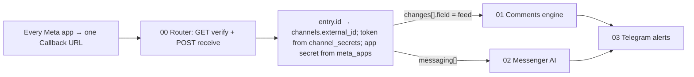

# Workflow Data Contract (n8n ⇄ Supabase)

This is the contract the **n8n v2 workflows** must follow. The dashboard and the database already store everything listed here. Staff edit it in the dashboard, and n8n reads it and writes the results back.

> [!IMPORTANT]
> n8n connects with the **service role** (Postgres credential or Supabase node with the `service_role` key). The tables `meta_apps`, `channel_secrets` and `channels` can't be reached from the browser at all, so only n8n and the dashboard's server routes can read secrets.

---

## 0. Architecture



- The single router URL is saved in **/channels → رابط الويب هوك (n8n)** (`bot_settings.n8n_webhook_url`).
- **GET verification:** accept the request when `hub.verify_token` equals **any** `meta_apps.webhook_verify_token` where `is_active = true`, then echo `hub.challenge`.
- **POST signature:** check `X-Hub-Signature-256` = `sha256=HMAC_SHA256(raw_body, meta_apps.app_secret)`. Find the app through `channels.external_id = entry.id` → `channels.meta_app_id`.
- Ignore an event when its channel is missing or `channels.status <> 'connected'`.
- Every Graph call should send `appsecret_proof = HMAC_SHA256(page_token, app_secret)` (hex). The dashboard does the same.

---

## 1. Shared reads (every event)

| Need | Read from | Edited in |
|---|---|---|
| Page / channel + token | `channels` (`external_id` = `entry.id`, `status`, `meta_app_id`) + `channel_secrets.access_token` | `/channels` |
| Verify token + app secret | `meta_apps.webhook_verify_token`, `meta_apps.app_secret` | `/channels` |
| Master switch | `bot_settings.bot_enabled` | `/settings` |
| Business hours | `bot_settings.business_hours_enabled`, `open_time`, `close_time` (Cairo time; `close_time < open_time` means it closes after midnight), `off_hours_message` | `/settings` |
| Restaurant identity | `bot_settings.restaurant_name`, `currency`, `delivery_fee` | `/settings` |
| Telegram | `bot_settings.notify_telegram`, `telegram_bot_token`, `telegram_chat_id` | `/settings` |

`bot_settings` is a single row. Read it with `select * from bot_settings limit 1`.

---

## 2. Comments flow (`changes[].field = 'feed'`, `value.item = 'comment'`, `value.verb = 'add'`)

### 2.1 Order of operations

1. **Lock / dedupe.** `INSERT INTO comment_events (comment_id, channel_id, post_id, parent_comment_id, commenter_id, commenter_name, comment_text, comment_created_at, decision) VALUES (..., 'pending') ON CONFLICT (comment_id) DO NOTHING RETURNING id`. If no row comes back, the comment was already handled, so **stop**.
2. **Load:** `comment_settings` (single row with `ai_enabled`, `ai_system_prompt`), `post_settings` for this `facebook_post_id`, active `comment_rules` (post & global overrides), and `bot_settings` (`price_list`, `restaurant_name`).
3. **Resolve:**
   - **Pre-checks:** Bot off, post bot off, page's own comment, nested reply ignore, mentions-only ignore.
   - **Complaint Keywords (Deterministic Guard):** `comment_settings.sensitive_keywords` → immediate complaint action.
   - **Specific Post / Keyword Rules (Optional Overrides):** If a specific rule matches for this post/keyword, run that rule.
   - **AI Comment Agent (The Primary Engine):** If `comment_settings.ai_enabled` is true (default), the comment text is evaluated by the AI using `comment_settings.ai_system_prompt` and the restaurant's `price_list`. The AI returns:
     ```json
     {
       "intent": "inquiry | complaint | spam_abuse | praise | general",
       "should_hide": boolean,
       "public_reply": string | null,
       "send_dm": boolean,
       "dm_message": string | null,
       "is_complaint": boolean,
       "notify_staff": boolean
     }
     ```
   - **Fallback:** If AI is disabled and no rule matches, mark as ignored (`no_rule`).

### 2.2 Running a rule (`comment_rules` columns)

| Column | Action |
|---|---|
| `reply_enabled` + `reply_variations[]` | Public reply with a random variation. Wait a random `reply_delay_min_sec`–`reply_delay_max_sec` first |
| `like_comment` | `POST /{comment-id}/likes` |
| `dm_enabled` + `dm_message`, `dm_image_url`, `dm_buttons` | Private reply: `POST /{page-id}/messages` with `recipient: {comment_id}`. Allowed **once per comment, within 7 days** |
| `dm_send_menu` | Attach `bot_settings.menu_images[]` (image attachments, in order) + `menu_pdf_url` link |
| `dm_send_offers` | Attach the active offers (see §3.3) |
| `hide_comment` | `POST /{comment-id}` with `is_hidden=true` |
| `create_complaint` | Insert into `complaints` (see §2.4) |
| `notify_staff` | Send a Telegram alert |

- **DM cooldown:** skip the DM, but still reply and like, if there is a `comment_events` row with the same `commenter_id`, `dm_sent = true` and `created_at > now() - dm_cooldown_hours`. Log `ignore_reason = 'cooldown'`.
- **Counters:** `UPDATE comment_rules SET total_triggers = total_triggers + 1, last_triggered_at = now() WHERE id = :rule_id`.
- **`dm_buttons`** is a JSON array of `{ "title": "...", "payload": "UPPER_CASE" }`. Messenger allows at most 3 buttons per message. Send them as `postback` buttons. These payloads are reserved:

| Payload | Meaning in the Messenger flow |
|---|---|
| `START_ORDER` | Start an order with the AI |
| `VIEW_MENU` | Send menu images + PDF |
| `VIEW_OFFERS` | Send active offers |
| `HUMAN_AGENT` | `request_human` (see §3.5) |

### 2.3 Complaint path (decision `complaint`)

It uses `comment_settings`:
- `complaint_public_reply` (polite text, never the cheerful reply)
- `complaint_dm_message`
- `complaint_hide_comment`
- `complaint_create_ticket`
- `complaint_notify_staff`

### 2.4 Write the result back to `comment_events`

`decision` (`replied` | `ignored` | `complaint` | `failed`), `ignore_reason`, `matched_rule_id`, `public_reply_text`, `public_reply_id`, `replied`, `liked`, `dm_sent`, `hidden`, `error_message`, `contact_id`, `complaint_id`, `processed_at = now()`.

Complaints from comments:

```sql
INSERT INTO complaints (customer_name, issue_description, source, comment_event_id, contact_id, priority, status)
VALUES (:commenter_name, :comment_text, 'comment', :event_id, :contact_id, 'medium', 'open');
```

> The dashboard Inbox (`/comments`) updates live from `comment_events`. Staff can reply, hide, like or mark rows as handled (`decision = 'manual'`).

---

## 3. Messenger flow (`entry[].messaging[]`)

### 3.1 Per message

1. Skip `message.is_echo = true` **unless** you want to log page-inbox replies by staff as `sender_type = 'agent'`.
2. **Upsert the contact:** match on (`channel_id`, `platform_user_id` = sender PSID), `platform = 'messenger'`. Fill `name` / `profile_pic_url` from `GET /{psid}?fields=first_name,last_name,profile_pic`.
3. **Store the incoming message:** `INSERT INTO messages (contact_id, sender_type, content, media_url, media_type, platform_message_id) VALUES (..., 'user', ..., :mid) ON CONFLICT (platform_message_id) DO NOTHING`. If nothing was inserted, it is a duplicate, so **stop**.
4. **Stop the AI** if any of these is true:
   - `bot_settings.bot_enabled = false`
   - `contacts.ai_enabled = false` (a human took over)
   - outside business hours (send `off_hours_message` at most once per conversation)
5. **Postbacks:** handle the §2.2 payloads directly. A new conversation can get `welcome_message`.

### 3.2 AI context

| Input | Source |
|---|---|
| System prompt | `bot_settings.ai_system_prompt` |
| Price list (text/Markdown) | `bot_settings.price_list` → e.g. `{{ $json.price_list }}` |
| Delivery fee / currency | `bot_settings.delivery_fee`, `currency` |
| Offers | §3.3 |
| Memory | Last ~20 `messages` for this contact, ordered by `created_at` |
| Customer | `contacts.name`, `phone`, `address`, `total_orders` |

### 3.3 Active offers query

```sql
SELECT title, description, price_before, price_after, banner_url
FROM offers
WHERE is_active
  AND (start_date IS NULL OR start_date <= now())
  AND (end_date   IS NULL OR end_date   >= now())
ORDER BY sort_order, created_at DESC;
```

### 3.4 AI tools → writes

| Tool | Writes |
|---|---|
| `create_order(items[], name, phone, address, notes)` (only after the customer confirms the summary) | `orders` with `status='confirmed'`, `contact_id`, `channel_id`, `customer_name`, `customer_phone`, `delivery_address`, `customer_notes`, `subtotal`, `delivery_fee`, `total_amount`, `payment_method`, `source='messenger'`; then `order_items` with `order_id`, `item_name`, `quantity`, `unit_price?`, `total_price?`, `notes?` (free text). Also update `contacts.name/phone/address` |
| `create_complaint(description, order_number?)` | `complaints` with `contact_id`, `customer_name`, `customer_phone`, `issue_description`, `order_id` (looked up from the customer's recent orders by `order_number`), `source='messenger'`, `status='open'`. A **DB trigger** sets the order to `issue`. If `bot_settings.auto_pause_on_complaint` is true, a trigger also sets `contacts.ai_enabled = false` |
| `send_menu()` | No DB writes; sends `menu_images[]` + `menu_pdf_url` |
| `request_human()` | See §3.5 |

> Check the real column names in `dashboard/src/types/database.types.ts`. Those types are generated from the live schema.

### 3.5 Human handoff (not a complaint)

```sql
UPDATE contacts SET ai_enabled = false, needs_human = true WHERE id = :contact_id;
```

- `needs_human_at` is set by a trigger.
- Reply with `bot_settings.human_handoff_message`.
- The contact gets a badge in Live Chat, and the sidebar shows a count.
- The flag clears automatically when staff send a reply successfully, or manually from the chat banner.

### 3.6 Every outgoing bot message

`INSERT INTO messages (contact_id, sender_type, content, media_url, platform_message_id) VALUES (..., 'bot', ..., :returned_message_id)`.

- Messenger allows replies **only within 24 hours** of the customer's last message.
- Outside that window, store the attempt with an error in `send_error`.

---

## 4. Telegram alerts flow

Send an alert on:
- a new `orders` row
- a new `complaints` row
- `contacts.needs_human` changing to `true`

Gate every alert on `bot_settings.notify_telegram`. It needs only those rows plus the Telegram settings.

## 5. Logic already in the database (don't duplicate it in n8n)

| Trigger / constraint | Effect |
|---|---|
| Complaint with `order_id` and status open/in_progress | Order `confirmed` → `issue` |
| New complaint and `auto_pause_on_complaint` | `contacts.ai_enabled = false` |
| New order | `contacts.total_orders += 1` |
| New message | `contacts.last_interaction_at` updated; an agent message with `send_error IS NULL` clears `needs_human` |
| `needs_human` changes | `needs_human_at` set / cleared |
| `comment_events.comment_id` UNIQUE | Comment dedupe |
| `messages.platform_message_id` UNIQUE | Message dedupe |

Resolving a complaint does **not** change the order automatically. The dashboard asks staff whether the order goes back to مؤكد or becomes ملغي.
