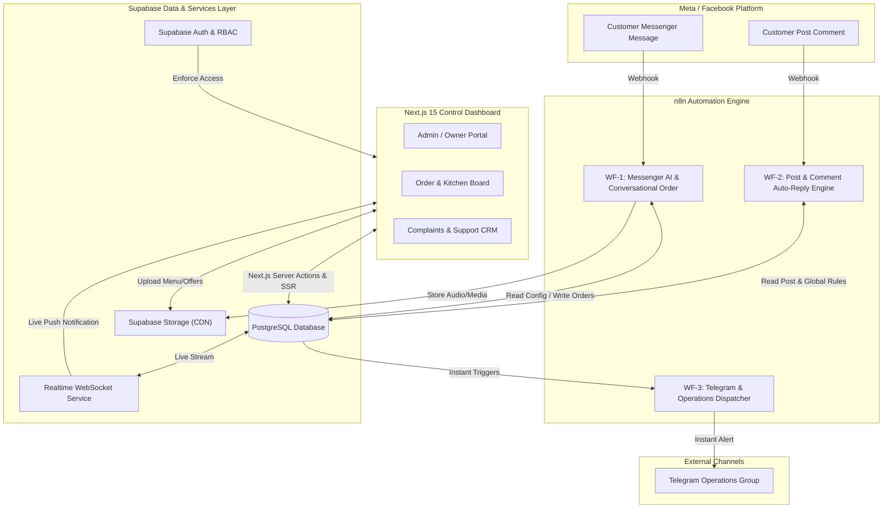

# Product Requirements Document (PRD) & Technical Specification

## Project: Intelligent Messenger Bot & Operations Control Dashboard
* **Target Channels**: Facebook Messenger & Facebook Page Post Comments (Omnichannel architecture ready for WhatsApp / Instagram expansion)
* **Core Stack**: Supabase (PostgreSQL, Auth, Storage, Realtime) + Next.js 15 (App Router, React 19, Tailwind CSS) + n8n Automation Workflows
* **Date**: October 8, 2026
* **Status**: Approved for Implementation

---

## 1. Executive Summary & Architecture Overview

The system provides an enterprise-grade automation solution for businesses (restaurants, retail, and service providers) that receive customer traffic via Facebook Page Comments and Messenger. It integrates:
1. **Intelligent n8n Workflows**: Conversational ordering, automated post-comment replies with private DMs, global fallback comment handling, and real-time operational alerts.
2. **Unified Supabase PostgreSQL Data Layer**: Single source of truth for dynamic bot configuration, menu items, marketing promotions, live orders, customer tickets, and staff permissions.
3. **Role-Based Web Dashboard (Next.js 15)**: Dedicated interfaces for the Business Owner/Admin, Order/Kitchen Staff, and Customer Support Agents with live audio/visual updates via WebSockets.

### High-Level Architecture Diagram



---

## 2. Comprehensive Database Schema (Supabase PostgreSQL)

### 2.1 Enums & Extensions
```sql
CREATE EXTENSION IF NOT EXISTS "uuid-ossp";

CREATE TYPE user_role AS ENUM ('admin', 'order_agent', 'support_agent');
CREATE TYPE order_status AS ENUM ('pending', 'confirmed', 'preparing', 'out_for_delivery', 'delivered', 'cancelled');
CREATE TYPE complaint_status AS ENUM ('open', 'in_progress', 'resolved', 'closed');
CREATE TYPE complaint_priority AS ENUM ('low', 'medium', 'high', 'urgent');
CREATE TYPE rule_match_type AS ENUM ('any', 'keywords');
```

### 2.2 Table Definitions

#### `profiles` (User Management & RBAC)
* Linked directly to Supabase Auth users.
```sql
CREATE TABLE profiles (
    id UUID PRIMARY KEY REFERENCES auth.users(id) ON DELETE CASCADE,
    full_name TEXT NOT NULL,
    role user_role NOT NULL DEFAULT 'order_agent',
    avatar_url TEXT,
    phone TEXT,
    is_active BOOLEAN NOT NULL DEFAULT TRUE,
    created_at TIMESTAMPTZ NOT NULL DEFAULT NOW(),
    updated_at TIMESTAMPTZ NOT NULL DEFAULT NOW()
);
```

#### `bot_settings` (Dynamic Master Configuration)
* Single-row table fetched dynamically by n8n nodes at execution time.
```sql
CREATE TABLE bot_settings (
    id UUID PRIMARY KEY DEFAULT uuid_generate_v4(),
    bot_enabled BOOLEAN NOT NULL DEFAULT TRUE,
    auto_pause_on_complaint BOOLEAN NOT NULL DEFAULT TRUE,
    notify_telegram BOOLEAN NOT NULL DEFAULT TRUE,
    telegram_bot_token TEXT,
    telegram_chat_id TEXT,
    notify_dashboard BOOLEAN NOT NULL DEFAULT TRUE,
    business_hours_enabled BOOLEAN NOT NULL DEFAULT FALSE,
    open_time TIME,
    close_time TIME,
    off_hours_message TEXT DEFAULT 'نحن خارج أوقات العمل الرسمية حالياً. سنتواصل معك فور بدء العمل!',
    ai_system_prompt TEXT DEFAULT 'أنت المساعد الذكي لمطعم الخديوي، أجب بلباقة وسرعة واجمع طلبات العملاء.',
    menu_full_image_url TEXT,
    menu_full_pdf_url TEXT,
    currency TEXT NOT NULL DEFAULT 'EGP',
    delivery_fee NUMERIC(10, 2) NOT NULL DEFAULT 0.00,
    updated_at TIMESTAMPTZ NOT NULL DEFAULT NOW()
);
```

#### `global_comment_rules` (Fallback for Unspecified Posts)
* Applied when a comment arrives on any post that does not have a dedicated entry in `post_rules`.
```sql
CREATE TABLE global_comment_rules (
    id UUID PRIMARY KEY DEFAULT uuid_generate_v4(),
    is_enabled BOOLEAN NOT NULL DEFAULT TRUE,
    auto_like_comment BOOLEAN NOT NULL DEFAULT TRUE,
    comment_replies TEXT[] NOT NULL DEFAULT ARRAY[
        'شرفتنا يا فندم! بعتنالك التفاصيل في رسايل الصفحة 📩❤️',
        'أهلاً بك! تم الرد على حضرتك في الخاص بكل التفاصيل 🌟',
        'منورنا دائماً! شيك على رسايلك الخاصة بعتنالك كل التفاصيل 💬✨'
    ],
    send_dm BOOLEAN NOT NULL DEFAULT TRUE,
    dm_message TEXT DEFAULT 'أهلاً بحضرتك في مطعم الخديوي! كيف نقدر نساعدك اليوم؟ تقدر تطلب الأوردر مباشرة أو تشوف عروضنا الحصرية 🌟',
    dm_image_url TEXT,
    dm_buttons JSONB DEFAULT '[
        {"title": "قائمة المنيو 🍔", "payload": "VIEW_MENU"},
        {"title": "العروض الحالية 🏷️", "payload": "VIEW_OFFERS"},
        {"title": "تحدث مع موظف 👨‍💼", "payload": "HUMAN_AGENT"}
    ]'::JSONB,
    updated_at TIMESTAMPTZ NOT NULL DEFAULT NOW()
);
```

#### `post_rules` (Post-Specific Comment & DM Triggers)
* Managed from the dashboard to attach automated marketing funnels to specific ad campaigns or viral posts.
```sql
CREATE TABLE post_rules (
    id UUID PRIMARY KEY DEFAULT uuid_generate_v4(),
    title TEXT NOT NULL,
    facebook_post_id TEXT NOT NULL UNIQUE,
    match_type rule_match_type NOT NULL DEFAULT 'any',
    trigger_keywords TEXT[] DEFAULT ARRAY[]::TEXT[],
    auto_like_comment BOOLEAN NOT NULL DEFAULT TRUE,
    comment_replies TEXT[] NOT NULL,
    dm_message TEXT NOT NULL,
    dm_image_url TEXT,
    dm_buttons JSONB DEFAULT '[]'::JSONB,
    is_active BOOLEAN NOT NULL DEFAULT TRUE,
    total_triggers INTEGER NOT NULL DEFAULT 0,
    created_at TIMESTAMPTZ NOT NULL DEFAULT NOW(),
    updated_at TIMESTAMPTZ NOT NULL DEFAULT NOW()
);
```

#### `offers` (Promotions Management)
```sql
CREATE TABLE offers (
    id UUID PRIMARY KEY DEFAULT uuid_generate_v4(),
    title TEXT NOT NULL,
    description TEXT,
    price_before NUMERIC(10, 2),
    price_after NUMERIC(10, 2) NOT NULL,
    banner_url TEXT NOT NULL,
    start_date TIMESTAMPTZ,
    end_date TIMESTAMPTZ,
    is_active BOOLEAN NOT NULL DEFAULT TRUE,
    sort_order INTEGER NOT NULL DEFAULT 0,
    created_at TIMESTAMPTZ NOT NULL DEFAULT NOW(),
    updated_at TIMESTAMPTZ NOT NULL DEFAULT NOW()
);
```

#### `menu_categories` & `menu_items` (Digital Catalog)
```sql
CREATE TABLE menu_categories (
    id UUID PRIMARY KEY DEFAULT uuid_generate_v4(),
    name_ar TEXT NOT NULL,
    name_en TEXT,
    image_url TEXT,
    sort_order INTEGER NOT NULL DEFAULT 0,
    is_active BOOLEAN NOT NULL DEFAULT TRUE,
    created_at TIMESTAMPTZ NOT NULL DEFAULT NOW()
);

CREATE TABLE menu_items (
    id UUID PRIMARY KEY DEFAULT uuid_generate_v4(),
    category_id UUID NOT NULL REFERENCES menu_categories(id) ON DELETE CASCADE,
    name_ar TEXT NOT NULL,
    name_en TEXT,
    description TEXT,
    price NUMERIC(10, 2) NOT NULL,
    sale_price NUMERIC(10, 2),
    image_url TEXT,
    is_available BOOLEAN NOT NULL DEFAULT TRUE,
    badges TEXT[] DEFAULT ARRAY[]::TEXT[],
    sort_order INTEGER NOT NULL DEFAULT 0,
    created_at TIMESTAMPTZ NOT NULL DEFAULT NOW(),
    updated_at TIMESTAMPTZ NOT NULL DEFAULT NOW()
);
```

#### `contacts` & `messages` (Customer Engagement Hub)
```sql
CREATE TABLE contacts (
    id UUID PRIMARY KEY DEFAULT uuid_generate_v4(),
    platform TEXT NOT NULL DEFAULT 'facebook',
    platform_user_id TEXT NOT NULL UNIQUE,
    name TEXT,
    phone TEXT,
    address TEXT,
    ai_enabled BOOLEAN NOT NULL DEFAULT TRUE,
    total_orders INTEGER NOT NULL DEFAULT 0,
    last_interaction_at TIMESTAMPTZ DEFAULT NOW(),
    created_at TIMESTAMPTZ NOT NULL DEFAULT NOW()
);

CREATE TABLE messages (
    id UUID PRIMARY KEY DEFAULT uuid_generate_v4(),
    contact_id UUID NOT NULL REFERENCES contacts(id) ON DELETE CASCADE,
    sender_type TEXT NOT NULL CHECK (sender_type IN ('user', 'bot', 'agent')),
    content TEXT,
    media_url TEXT,
    media_type TEXT,
    is_read BOOLEAN NOT NULL DEFAULT FALSE,
    created_at TIMESTAMPTZ NOT NULL DEFAULT NOW()
);
```

#### `orders` & `order_items` (Order Fulfillment Pipeline)
```sql
CREATE TABLE orders (
    id UUID PRIMARY KEY DEFAULT uuid_generate_v4(),
    order_number SERIAL UNIQUE,
    contact_id UUID REFERENCES contacts(id) ON DELETE SET NULL,
    customer_name TEXT NOT NULL,
    customer_phone TEXT NOT NULL,
    delivery_address TEXT NOT NULL,
    subtotal NUMERIC(10, 2) NOT NULL DEFAULT 0.00,
    delivery_fee NUMERIC(10, 2) NOT NULL DEFAULT 0.00,
    total_amount NUMERIC(10, 2) NOT NULL DEFAULT 0.00,
    status order_status NOT NULL DEFAULT 'pending',
    payment_method TEXT NOT NULL DEFAULT 'cash_on_delivery',
    internal_notes TEXT,
    source TEXT NOT NULL DEFAULT 'messenger',
    created_at TIMESTAMPTZ NOT NULL DEFAULT NOW(),
    updated_at TIMESTAMPTZ NOT NULL DEFAULT NOW()
);

CREATE TABLE order_items (
    id UUID PRIMARY KEY DEFAULT uuid_generate_v4(),
    order_id UUID NOT NULL REFERENCES orders(id) ON DELETE CASCADE,
    menu_item_id UUID REFERENCES menu_items(id) ON DELETE SET NULL,
    item_name TEXT NOT NULL,
    quantity INTEGER NOT NULL DEFAULT 1,
    unit_price NUMERIC(10, 2) NOT NULL,
    total_price NUMERIC(10, 2) NOT NULL,
    notes TEXT
);
```

#### `complaints` (CRM Ticket Resolution)
```sql
CREATE TABLE complaints (
    id UUID PRIMARY KEY DEFAULT uuid_generate_v4(),
    ticket_number SERIAL UNIQUE,
    contact_id UUID REFERENCES contacts(id) ON DELETE SET NULL,
    customer_name TEXT NOT NULL,
    customer_phone TEXT NOT NULL,
    issue_description TEXT NOT NULL,
    priority complaint_priority NOT NULL DEFAULT 'medium',
    status complaint_status NOT NULL DEFAULT 'open',
    assigned_to UUID REFERENCES profiles(id) ON DELETE SET NULL,
    resolution_notes TEXT,
    created_at TIMESTAMPTZ NOT NULL DEFAULT NOW(),
    resolved_at TIMESTAMPTZ
);
```

### 2.3 Row Level Security (RLS) & Access Control
1. **`admin`**: Full access (`SELECT`, `INSERT`, `UPDATE`, `DELETE`) on all tables.
2. **`order_agent`**:
   - `SELECT`, `UPDATE` on `orders` and `order_items`.
   - `SELECT` on `menu_categories`, `menu_items`, `offers`, and `contacts`.
3. **`support_agent`**:
   - `SELECT`, `INSERT`, `UPDATE` on `complaints`.
   - `SELECT`, `UPDATE` on `contacts` (toggle `ai_enabled`).
   - `SELECT`, `INSERT` on `messages` for manual chat takeover.
4. **`service_role` (used by n8n)**: Bypasses RLS to read and insert incoming events without user authentication restrictions.

---

## 3. n8n Automation Workflows Architecture

### Workflow 1: Messenger Webhook & Conversational AI Ordering Engine
* **Trigger**: Webhook receiving `messages` events from Facebook Graph API.
* **Flow**:
  1. **Deduplication & Contact Resolution**: Extract sender PSID. Fetch or upsert contact record in `contacts`.
  2. **Human Handoff Check**: If `contacts.ai_enabled == false`, log message to `messages` table and bypass AI response (allowing agent to reply via dashboard).
  3. **Intent Classification & Routing**:
     - *Menu Request*: Query `bot_settings.menu_full_image_url` or fetch active categories from `menu_categories` and return generic template carousel cards.
     - *Offers Request*: Query `offers` where `is_active = true` and `NOW() BETWEEN start_date AND end_date`, return rich image cards with discounts.
     - *Complaint Filing*: If user expresses strong frustration, prompt for details, insert record into `complaints`. Check `bot_settings.auto_pause_on_complaint`:
       - If `true`: set `contacts.ai_enabled = false`, inform user that a senior representative is reviewing the case, and trigger alert.
       - If `false`: log ticket with ticket number, alert support, keep bot interactive.
     - *Order Placement (Conversational LLM)*: LangChain agent with Gemini 2.0 Flash / OpenAI. Agent has tool access to query `menu_items`. It asks for item quantities, phone, address. When confirmed, calls `create_order` tool inserting into `orders` and `order_items`.

### Workflow 2: Post & Comment Auto-Reply Engine
* **Trigger**: Webhook receiving `feed` events (`item == 'comment'`).
* **Flow**:
  1. Filter out comments made by the Page itself.
  2. **Rule Lookup**: Query `post_rules` where `facebook_post_id == event.post_id` AND `is_active == true`.
  3. **Branch A (Specific Post Rule Exists)**:
     - Check `match_type`:
       - If `'any'`: Always match.
       - If `'keywords'`: Check if comment message contains any string in `trigger_keywords`.
     - *Action 1 (Public Comment)*: Select a random entry from `comment_replies`. Call Facebook Graph API `POST /{comment_id}/comments`. If `auto_like_comment == true`, call `POST /{comment_id}/likes`.
     - *Action 2 (Private DM)*: Call Facebook Graph API `POST /me/messages` with `recipient: {"comment_id": comment_id}` sending `dm_message`, optional `dm_image_url`, and `dm_buttons`.
     - Increment `post_rules.total_triggers`.
  4. **Branch B (No Specific Rule / Unspecified Post Fallback)**:
     - Query `global_comment_rules`.
     - If `is_enabled == true`:
       - Select random reply from `global_comment_rules.comment_replies` and post public comment.
       - If `global_comment_rules.auto_like_comment == true`, like comment.
       - If `global_comment_rules.send_dm == true`, send `global_comment_rules.dm_message` + quick-reply buttons directly to the commenter's inbox.

### Workflow 3: Operations & Telegram Dispatcher
* **Trigger**: Database webhook or n8n sub-workflow call on `orders.INSERT` or `complaints.INSERT`.
* **Logic**:
  - Check `bot_settings.notify_telegram`.
  - Format rich HTML Telegram notification:
    - 🛒 **New Order #ORD-X**: Customer name, phone, full address, itemized list, total price.
    - ⚠️ **New Complaint #CMP-Y**: Priority indicator, customer phone, issue summary.
  - Send message via Telegram Bot API to `bot_settings.telegram_chat_id`.

---

## 4. Control Dashboard Specification (Next.js 15)

### 4.1 Navigation & Screen Structure

| Route | Role Access | Purpose & Features |
| :--- | :--- | :--- |
| `/login` | Public | Supabase Auth email/password login. |
| `/dashboard` | All Roles | High-level metrics: Today's Orders, Revenue, Pending Complaints, Active Offers. |
| `/dashboard/orders` | Admin, Order Agent | Real-time Kanban & Table view of orders. Status transitions, thermal receipt printing, sound alerts. |
| `/dashboard/complaints` | Admin, Support Agent | Ticket queue with Priority tags, assignment to agents, resolution notes, and one-click chat handoff. |
| `/dashboard/menu` | Admin | Categories & item management, pricing, photo uploads to Supabase CDN, in-stock switches, and Master Menu PDF upload. |
| `/dashboard/offers` | Admin | Create/Edit marketing offers, banner image upload, active dates, and preview. |
| `/dashboard/post-rules` | Admin | Tab 1: Post-specific rules (ID, match criteria, reply variations, DM body). Tab 2: Global comment fallback settings. |
| `/dashboard/chat` | Admin, Support Agent | Live chat view with customers. Toggle AI on/off, manual replies. |
| `/dashboard/settings` | Admin | Telegram bot token/chat ID, business hours, AI system prompt, delivery fee. |
| `/dashboard/team` | Admin | Invite agents, change roles (`admin`, `order_agent`, `support_agent`), deactivate accounts. |

### 4.2 Key User Interface Patterns
* **Audio Alerts for Kitchen/Orders**: Built-in sound player triggered via Supabase Realtime when `INSERT` on `orders` happens.
* **Badge Indicators**: Unread complaints and pending orders display red numeric counters on the sidebar navigation.
* **Role Redirection**: If an `order_agent` logs in, they are immediately redirected to `/dashboard/orders` and restricted from settings/menu editing.

---

## 5. Security, Reliability & Verification

1. **Meta Anti-Spam Compliance**:
   - Facebook flags identical repeated comment replies. The system mandates an array of minimum 3 randomized variations in `post_rules` and `global_comment_rules`.
2. **Environment Separation & Safe Storage**:
   - Platform secrets (`FACEBOOK_PAGE_ACCESS_TOKEN`, `SUPABASE_SERVICE_ROLE_KEY`, `TELEGRAM_BOT_TOKEN`) reside securely in environment variables and are never exposed to client-side bundles.
3. **Graceful Fallbacks**:
   - If AI fails or exceeds token limits, the bot sends a standard polite fallback message and marks the contact for agent attention.
   - If Facebook Graph API rate-limits, n8n retry-on-fail mechanisms ensure messages are queued.

---

## 6. Implementation Roadmap

* **Phase 1: Database Setup & Supabase Migration**: Deploy SQL schema, RLS policies, storage buckets (`menu-assets`, `offer-banners`), and seed default settings.
* **Phase 2: n8n Workflow Build**:
  - Deploy Workflow 1 (Messenger AI & Orders).
  - Deploy Workflow 2 (Post & Global Comments).
  - Deploy Workflow 3 (Telegram Alerts).
* **Phase 3: Next.js 15 Dashboard Foundation**: Project initialization, Supabase SSR auth, layout with role-based routing.
* **Phase 4: Dashboard Modules**:
  - Orders Kanban & Realtime updates.
  - Complaints Management & Live Chat.
  - Menu & Offers Management with CDN Upload.
  - Post-Rules & Global Comments UI.
  - System Settings & Team RBAC.
* **Phase 5: End-to-End Testing & Handover**.
