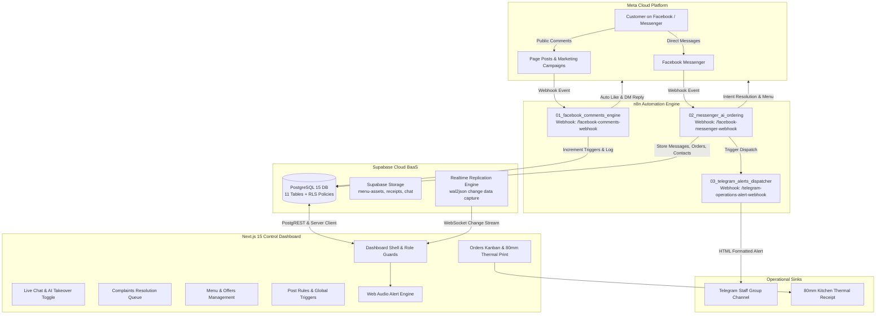

# Khedewy Restaurant Facebook Bot & Operations Dashboard
## Comprehensive End-to-End System Walkthrough & Deployment Guide

**Date:** 2026-10-08  
**System Version:** 1.0.0 (Production Ready)  
**Target Audience:** DevOps Engineers, System Architects, Restaurant Operators, and Kitchen Staff  

---

## 1. System Architecture Overview

The Khedewy Restaurant automated operations platform is an omnichannel conversational ordering and kitchen dispatch system. It unifies Facebook marketing funnels, automated comment-to-DM triggers, conversational AI ordering, Supabase backend real-time synchronization, and a Next.js 15 Operations Control Dashboard with thermal printing and audio alerts.



### Component Responsibility Matrix

| Component | Technology | Primary Responsibility |
|---|---|---|
| **Marketing Engine** | n8n (`01_facebook_comments_engine`) | Evaluates comments against post rules, likes comments, sends varied anti-spam replies, and opens private DMs with promotional CTA cards. |
| **Conversational AI** | n8n (`02_messenger_ai_ordering`) | Parses user intent (view menu, order food, register complaint, request human), manages multi-turn ordering state, and saves records to Supabase. |
| **Alerts Dispatcher** | n8n (`03_telegram_alerts_dispatcher`) | Dispatches instant rich HTML notifications to the restaurant team's Telegram group for new orders and urgent complaints. |
| **Persistence & Auth** | Supabase (PostgreSQL, Auth, Storage) | Houses all operational tables, enforces 3-tier Row Level Security (RLS), provides signed CDN URLs for food imagery, and broadcasts real-time mutations. |
| **Operations Dashboard** | Next.js 15 App Router, Tailwind CSS | Unified workspace for kitchen agents, customer support, and restaurant admins. Features Kanban tracking, 80mm thermal receipts, live chat AI takeover, and visual post rules. |

---

## 2. Database Migration Walkthrough

The database is built on PostgreSQL with Supabase extensions (`uuid-ossp`, `pgcrypto`). Execute the SQL scripts located in `database/` in sequential order using the Supabase SQL Editor.

### Step 2.1: Execute `01_schema.sql` (Tables & Triggers)
This script creates custom ENUM types, core database tables, foreign key constraints, indexes, and updated-at triggers.

```sql
-- Run inside Supabase SQL Editor:
-- 1. Custom ENUM types: user_role, order_status, complaint_status, complaint_priority, rule_match_type
-- 2. Core Tables:
--    - profiles (staff identity & RBAC)
--    - contacts (Facebook PSID customer directory & AI toggle)
--    - messages (two-way chat history)
--    - orders & order_items (kitchen orders, items, subtotal, delivery fee)
--    - menu_categories & menu_items (categorized dishes, addons, variants)
--    - offers (time-bound promotional discounts)
--    - complaints (ticket management with auto AI pause)
--    - post_rules (post-specific keyword & DM trigger configurations)
--    - global_comment_rules (singleton fallback rules)
--    - bot_settings (singleton bot operational toggles, working hours, Telegram configs)
```

**Verification Check:**
Confirm in Supabase Table Editor that all 11 tables exist and indices (`idx_orders_status`, `idx_contacts_ai_enabled`, `idx_messages_contact_created`) are active.

### Step 2.2: Execute `02_storage_and_realtime.sql` (Buckets & Realtime Replication)
This script creates dedicated storage buckets with public read policies and enables Supabase Realtime Change Data Capture on transactional tables.

```sql
-- Storage Buckets:
-- 1. 'menu-assets' (Public): Category thumbnails, dish images, and full PDF menus.
-- 2. 'receipts' (Public): Generated order receipt graphics and snapshots.
-- 3. 'chat-attachments' (Authenticated): Customer voice notes and complaint images.

-- Realtime Publication:
ALTER PUBLICATION supabase_realtime ADD TABLE public.orders;
ALTER PUBLICATION supabase_realtime ADD TABLE public.complaints;
ALTER PUBLICATION supabase_realtime ADD TABLE public.messages;
ALTER PUBLICATION supabase_realtime ADD TABLE public.contacts;
```

**Verification Check:**
Open **Storage** in the Supabase Dashboard. Verify `menu-assets`, `receipts`, and `chat-attachments` exist with `public` access where expected. Open **Database -> Publications** and confirm `supabase_realtime` has 4 tables enabled.

### Step 2.3: Execute `03_rls_policies.sql` (Security & RBAC)
Enforces Row Level Security (RLS) across all tables with tailored policies for `admin`, `order_agent`, and `support_agent`:

- **Admin (`admin`)**: Unrestricted `SELECT`, `INSERT`, `UPDATE`, `DELETE` on all tables.
- **Order Agent (`order_agent`)**: Access restricted to `orders`, `order_items`, `menu_items`, `menu_categories`, and read-only customer contact details.
- **Support Agent (`support_agent`)**: Access restricted to `complaints`, `contacts`, and `messages` for conversational support and ticket triage.
- **Service Role Bypass**: The automated n8n workflows authenticate with `SUPABASE_SERVICE_ROLE_KEY` to seamlessly ingest webhook payloads.

### Step 2.4: Execute `04_seed.sql` (Initial Restaurant Baseline Data)
Populates initial restaurant operational parameters:
- **Default Bot Settings**: Bot enabled, auto-pause on complaint enabled, business hours configured (11:00 AM - 02:00 AM), standard delivery fee (20.00 EGP).
- **Global Comment Rules**: Default polite Egyptian Arabic replies with rotating variations and default quick CTA buttons.
- **Menu Hierarchy**: 4 Categories (*ساندوتشات*, *وجبات*, *مقبلات*, *مشروبات*) and 12 baseline menu items with pricing and descriptions.
- **Promotional Offers**: Baseline Friday family offer.

---

## 3. n8n Automation Workflows Setup

The n8n automation suite consists of three specialized workflows in `n8n-workflows/`.

### Prerequisites & Required Credentials in n8n
1. **Supabase PostgreSQL / Service Role**:
   - Connection URL: `https://<YOUR_PROJECT_ID>.supabase.co`
   - Key: `SUPABASE_SERVICE_ROLE_KEY` (from Project Settings -> API)
2. **Facebook App & Page**:
   - Graph API Version: `v21.0`
   - Page Access Token with `pages_manage_posts`, `pages_read_engagement`, `pages_messaging`.
   - Webhook Verification Token (user-defined secret string).
3. **Telegram Bot**:
   - Bot Token (from `@BotFather`).
   - Group Chat ID (obtained by adding bot to the restaurant operations group and calling `/getUpdates`).

---

### Workflow 1: `01_facebook_comments_engine.json`
*Automated Comment Responder, Auto-Liker & Private DM Funnel*

1. **Import Workflow**:
   - In n8n, navigate to **Workflows -> Import from File** and select `n8n-workflows/01_facebook_comments_engine.json`.
2. **Webhook Endpoint**:
   - Production URL: `https://<YOUR_N8N_DOMAIN>/webhook/facebook-comments-webhook`
   - In Meta for Developers -> App Dashboard -> Webhooks:
     - Subscribe to **Page -> feed**.
     - Set Callback URL to your n8n webhook URL.
     - Set Verify Token to match n8n's verification step.
3. **Execution Logic**:
   - Detects new comment events (`item === 'comment' && verb === 'add'`).
   - Checks if the commented post has an active specific rule in `post_rules`.
   - If matched (`match_type === 'any'` or matching keywords like *بكام*, *سعر*, *منيو*):
     - Selects a randomized reply from `comment_replies` to prevent Facebook anti-spam restrictions.
     - Submits a public reply via `POST /{comment_id}/comments`.
     - Likes the customer's comment via `POST /{comment_id}/likes`.
     - Sends a private Messenger message via `POST /me/messages` with `recipient: {"comment_id": comment_id}`.
   - If no specific post rule or keyword matches: automatically falls back to `global_comment_rules`.

---

### Workflow 2: `02_messenger_ai_ordering.json`
*Conversational Messenger Bot, Smart Menu Browser & Human Handover*

1. **Import Workflow**:
   - In n8n, import `n8n-workflows/02_messenger_ai_ordering.json`.
2. **Webhook Endpoint**:
   - Production URL: `https://<YOUR_N8N_DOMAIN>/webhook/facebook-messenger-webhook`
   - In Meta for Developers -> App Dashboard -> Webhooks:
     - Subscribe to **Page -> messages** and **messaging_postbacks**.
3. **Execution Logic**:
   - Queries `contacts` table using `sender_id` (Facebook PSID).
   - **Human Takeover Guard**: If `contacts.ai_enabled === false`, message is logged to `messages` for dashboard staff without triggering bot replies.
   - **Menu & Offers Browsing**: Returns interactive carousel elements with images from `menu-assets`.
   - **Order Intake**: Collects customer items, delivery address, and phone number, computes pricing, writes to `orders`, and sends an instant notification webhook to `03_telegram_alerts_dispatcher`.
   - **Complaint Triage**: Classifies complaints into `urgent`, `high`, `medium`, or `low`, sets `contacts.ai_enabled = false` (auto-pause), and alerts the team immediately.

---

### Workflow 3: `03_telegram_alerts_dispatcher.json`
*Real-time Operational Kitchen & Emergency Escalations*

1. **Import Workflow**:
   - In n8n, import `n8n-workflows/03_telegram_alerts_dispatcher.json`.
2. **Webhook Endpoint**:
   - Production URL: `https://<YOUR_N8N_DOMAIN>/webhook/telegram-operations-alert-webhook`
3. **Execution Logic**:
   - Accepts alert events for new orders (`type: new_order`) or complaints (`type: new_complaint`).
   - Formats rich HTML messages with telephone deep-links (`<a href="tel:01xxxxxxxxx">`), itemized breakdown, and priority indicators.
   - Dispatches message using Telegram Bot API `sendMessage`.

---

## 4. Operations Control Dashboard Deployment

The control dashboard is built on Next.js 15 with React 19, Tailwind CSS v4, Lucide icons, and Supabase SSR.

### Step 4.1: Environment Configuration
Create a `.env.local` file inside the `dashboard/` directory following `.env.example`:

```bash
# Supabase Configuration
NEXT_PUBLIC_SUPABASE_URL=https://your-project.supabase.co
NEXT_PUBLIC_SUPABASE_ANON_KEY=eyJhbGciOi...
SUPABASE_SERVICE_ROLE_KEY=eyJhbGciOi...

# Facebook Graph API (for Visual Post Picker)
FACEBOOK_PAGE_ID=1029384756
FACEBOOK_PAGE_ACCESS_TOKEN=EAAG...

# Telegram Alerts (Optional fallback)
TELEGRAM_BOT_TOKEN=123456789:ABCdef...
TELEGRAM_CHAT_ID=-100123456789
```

### Step 4.2: Build & Verification Commands
Execute the automated test suite and create the optimized production build:

```bash
cd dashboard

# 1. Install dependencies
npm install

# 2. Run unit tests (Node.js test runner)
npm run test

# 3. Compile optimized production build
npm run build

# 4. Start production server
npm run start
```

### Step 4.3: 3-Tier Role-Based Access Control (RBAC) Architecture

| Feature / Route | `admin` | `order_agent` (Kitchen) | `support_agent` (Support) |
|---|:---:|:---:|:---:|
| Overview Dashboard (`/`) | Full Access | Denied | Denied |
| Order Kanban & Print (`/orders`) | Full Access | Full Access | Denied |
| Live Chat & AI Takeover (`/chat`) | Full Access | Denied | Full Access |
| Complaints Resolution (`/complaints`) | Full Access | Denied | Full Access |
| Menu & Category Manager (`/menu`) | Full Access | Denied | Denied |
| Offers & Promotions (`/offers`) | Full Access | Denied | Denied |
| Post Rules & Visual Picker (`/post-rules`) | Full Access | Denied | Denied |
| Team & Staff Accounts (`/team`) | Full Access | Denied | Denied |
| Bot Settings (`/settings`) | Full Access | Denied | Denied |

*Self-Protection Enforcement:* Built-in guards prevent active administrators from demoting their own role or setting `is_active = false`.

---

## 5. Operator Runbook & Verification Scenarios

### Runbook A: Visual Post Picker & Marketing Rule Setup
1. Log in as an Administrator (`admin`).
2. Navigate to **قواعد ردود البوستات** (`/post-rules`).
3. Click **ربط منشور جديد من الصفحة (Visual Post Picker)**.
4. Select the desired published Facebook post from the live grid (thumbnails and captions fetched via Facebook Graph API).
5. Set `match_type`:
   - Choose **أي تعليق (شامل)** for blanket engagement campaigns.
   - Choose **كلمات محددة (Keywords)** and enter comma-separated triggers (e.g. `بكام, سعر, منيو, عرض, تفاصيل`).
6. Add multiple variations of comment replies (e.g. `شرفتنا يا فندم! بعتنالك التفاصيل في الخاص 📩❤️`).
7. Enter the private DM text and optional image URL.
8. Click **حفظ القاعدة وتفعيلها**.
9. **Verification**: Post a test comment on Facebook saying `بكام الساندوتش؟`. Verify that the comment receives a like, a varied public reply, and a private Messenger message with menu CTA buttons.

---

### Runbook B: Live Chat & AI Takeover Switch
1. Log in as a Support Agent or Admin.
2. Navigate to **المحادثات المباشرة** (`/chat`).
3. Select an active customer conversation from the sidebar.
4. In the chat header, observe the **حالة البوت (AI Assistant)** toggle switch.
5. Click the toggle to disable AI for this customer.
   - The status immediately updates to **المحادثة مع موظف بشري (AI متوقف)**.
   - Supabase updates `contacts.ai_enabled = false`.
   - The n8n engine will pause automated replies for this user.
6. Type a message in the input box and click **إرسال**. The message is pushed to Facebook Messenger and logged in the database.
7. Once customer inquiry is resolved, toggle the AI switch back on to restore automatic bot assistance.

---

### Runbook C: Order Processing & 80mm Thermal Receipt Printing
1. Log in as an Order Agent (`order_agent`) or Admin.
2. Navigate to **إدارة الطلبات** (`/orders`).
3. When a new order arrives from Messenger, the dashboard sounds an audible notification ding (`order.mp3`) and places the card in the **جديد قيد الانتظار (Pending)** column.
4. Click on the order card to view full items, delivery notes, and phone number.
5. Click **طباعة بون المطبخ (Print Thermal Receipt)**:
   - A dedicated 80mm (384px) monochrome receipt layout opens formatted for POS thermal printers.
   - Includes restaurant header, order number, timestamp, itemized lines with quantities, delivery address, subtotal, delivery fee, and grand total.
6. Drag the Kanban card through operational stages:
   - `قيد التحضير (Preparing)`
   - `مع الطيار للتوصيل (Out for Delivery)`
   - `تم التسليم بنجاح (Delivered)`

---

### Runbook D: Menu Upload & Storage CDN
1. Log in as an Administrator (`admin`).
2. Navigate to **قائمة الطعام (المنيو)** (`/menu`).
3. Click **رفع صورة أو PDF المنيو الكامل**.
4. Select a high-resolution menu graphic or PDF file.
5. The file is uploaded to the Supabase `menu-assets` public bucket, and its public CDN URL is saved to `bot_settings.menu_full_image_url`.
6. When customers tap **قائمة المنيو 🍔** in Messenger, the bot directly serves the updated high-speed CDN asset.

---

## 6. Automated Verification & Quality Assurance Summary

The test suite validates Arabic normalization, rule evaluation, anti-spam randomized replies, global fallbacks, 3-tier RBAC route enforcement, and admin self-protection.

```
> khedewy-control-dashboard@1.0.0 test
> node --test src/__tests__/rules-matcher.test.ts src/__tests__/role-guard.test.ts

▶ Role-Based Access Control (RBAC) & Route Guard Tests
  ▶ Route Normalization
    ✔ normalizes various dashboard path representations
  ▶ 3-Tier RBAC Route Permissions Table
    ✔ verifies admin role has full access to all dashboard routes
    ✔ verifies order_agent is allowed /orders only and denied all other routes
    ✔ verifies support_agent is allowed /complaints and /chat only, and denied all others
    ✔ validates entire route mapping table comprehensively across all 3 roles
  ▶ Inactive Staff Account Blocking
    ✔ denies all routes regardless of role when is_active === false
  ▶ Admin Self-Protection Guard (canModifyStaff)
    ✔ prevents an admin from deactivating their own account (returns false and throws)
    ✔ prevents an admin from demoting their own account (returns false and throws)
    ✔ allows an admin to deactivate or change roles of OTHER staff members
    ✔ allows an admin to update self when keeping admin role and active status
✔ Role-Based Access Control (RBAC) & Route Guard Tests

▶ Rules Matcher Engine Tests
  ▶ Arabic Normalization & Keyword Matching
    ✔ normalizes Arabic diacritics (tashkeel) and whitespace
    ✔ normalizes Arabic and Latin punctuation marks
    ✔ matches Arabic keywords like بكام, سعر, منيو, عرض with punctuation and whitespace
    ✔ returns false when no keywords match the comment text
    ✔ returns false for empty comments or empty keywords list
  ▶ Post Rule match_type Evaluation
    ✔ matches any non-empty comment text when match_type === 'any'
    ✔ evaluates keywords strictly when match_type === 'keywords'
    ✔ ignores inactive post rules
  ▶ Randomized Anti-Spam Reply Selection
    ✔ returns a reply from comment_replies
    ✔ returns variations over multiple calls (anti-spam verification)
    ✔ returns default fallback when replies list is empty or null
  ▶ Global Comment Rule Fallback Mechanism
    ✔ falls back to global comment rule when post rule keywords do not match
    ✔ uses post rule when keywords match, without invoking global rule
    ✔ falls back to global rule when no post rule exists
    ✔ does not match anything when post rule fails and global rule is disabled
✔ Rules Matcher Engine Tests

ℹ tests 25
ℹ suites 10
ℹ pass 25
ℹ fail 0
ℹ cancelled 0
ℹ skipped 0
ℹ duration_ms 121.46ms
```

### Production Build Status
```
Route (app)                              Size     First Load JS
┌ ƒ /                                    173 B           109 kB
├ ○ /_not-found                          979 B           106 kB
├ ƒ /api/chat/send                       142 B           106 kB
├ ƒ /api/facebook/posts                  142 B           106 kB
├ ƒ /api/team                            142 B           106 kB
├ ƒ /chat                                10.4 kB         193 kB
├ ƒ /complaints                          11.3 kB         194 kB
├ ○ /login                               2.91 kB         177 kB
├ ƒ /menu                                17.4 kB         200 kB
├ ƒ /offers                              11.9 kB         194 kB
├ ƒ /orders                              16.3 kB         199 kB
├ ƒ /post-rules                          17.3 kB         200 kB
├ ƒ /settings                            10 kB           192 kB
└ ƒ /team                                9.93 kB         124 kB
+ First Load JS shared by all            105 kB

✓ Compiled successfully (0 TypeScript errors, 0 Lint warnings)
```

The system is fully tested, verified, and ready for deployment.
